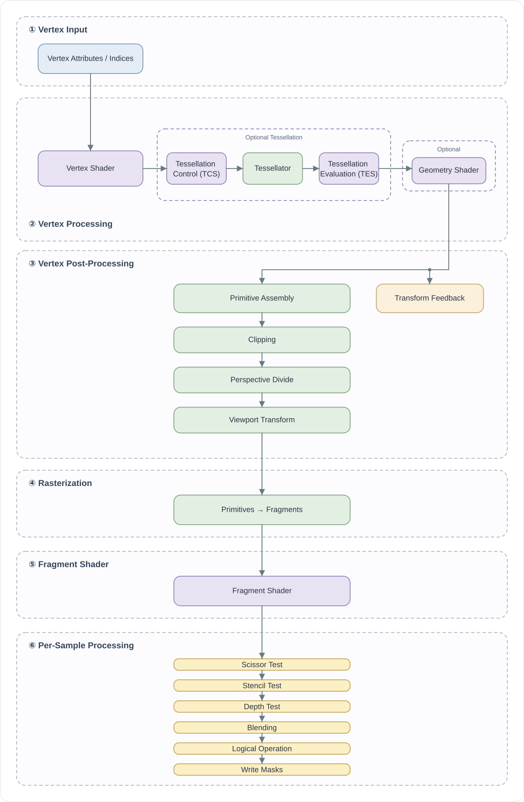

## OpenGL

**渲染管线（Rendering Pipeline）**是 OpenGL 在渲染物体时所执行的一系列步骤。本概述将从宏观层面介绍该管线中的各个步骤。

当执行一次渲染操作时，OpenGL 渲染管线便会启动。渲染操作以一个正确定义的顶点数组对象作为输入，并拥有一个已链接的程序对象（Program Object），后者用于为可编程管线阶段提供着色器。管线启动后，将按照以下顺序运行：


_OpenGL 渲染管线框图_

图中按 Vertex Input、Vertex Processing、Vertex Post-Processing、Rasterization、Fragment Shader 和 Per-Sample Processing 展示 OpenGL 渲染管线的主要步骤阶段。蓝色表示顶点输入，紫色表示可编程着色器阶段，绿色表示固定功能处理，黄色表示逐样本操作及变换反馈输出。灰色虚线框用于区分主要阶段，紫色虚线框标出可选阶段。

细分控制着色器、细分计算着色器和几何着色器都是可选阶段。变换反馈从顶点处理输出分支捕获数据，不是通往光栅化的必经节点。逐样本操作按常见逻辑顺序排列；满足条件时，深度和模板等测试也可能提前到片段着色器之前执行。

### Vertex Processing

顶点处理（[Vertex Processing](https://www.khronos.org/opengl/wiki/Vertex_Processing)）负责使用程序中的着色器阶段处理图元的顶点，并生成供顶点后处理和光栅化使用的顶点数据。顶点处理由顶点着色器开始，随后可以执行可选的细分着色器和几何着色器。

顶点处理中的顶点着色器或细分计算着色器可以使用以下内置变量：

```glsl
// 顶点着色器的输入
in int gl_VertexID;
in int gl_InstanceID;
in int gl_DrawID;
in int gl_BaseVertex;
in int gl_BaseInstance;

// 顶点着色器或细分计算着色器的输出
out gl_PerVertex
{
  vec4 gl_Position;
  float gl_PointSize;
  float gl_ClipDistance[];
};
```

其中，gl_VertexID 是顶点在当前绘制命令中的索引，gl_InstanceID 是顶点所在实例的索引。gl_VertexID 不包括 gl_BaseVertex，而 gl_InstanceID 不包括 gl_BaseInstance。

#### Vertex Shader

顶点着色器（Vertex Shader）是顶点处理中的强制着色器阶段。渲染操作会为图元中的每个顶点执行一次顶点着色器。顶点着色器的典型用途包括顶点变换、为片段着色器生成插值数据，以及执行逐顶点光照。

顶点着色器接收顶点属性作为输入，并通常将裁切空间位置写入 gl_Position。顶点着色器还可以声明任意用户自定义输出变量，这些变量会由后续着色器阶段使用或在光栅化过程中进行插值。

#### Tessellation

细分（Tessellation）是可选的顶点处理阶段，可将较少的顶点所描述的简单图元拆分为更多更小的图元。细分处理由细分控制着色器、固定功能的细分原语生成器和细分计算着色器组成。

细分控制着色器（Tessellation Control Shader，TCS）以图元的控制顶点为输入，并定义细分级别以及输出的控制顶点。细分原语生成器会根据这些细分级别生成一组新的顶点及其重心坐标。

细分计算着色器（Tessellation Evaluation Shader，TES）读取细分控制着色器输出的控制顶点，并使用细分原语生成器提供的坐标计算每个新顶点的位置及其他数据。它通常负责计算细分后的顶点位置，因此可用于地形细分、曲面细分和位移贴图。

细分控制着色器和细分计算着色器也可以单独使用。两者都启用时，细分控制着色器先执行，固定功能的细分原语生成器随后对图元进行细分，最后由细分计算着色器处理生成的顶点。

#### Geometry Shader

几何着色器（Geometry Shader）是可选的顶点处理阶段。它以一个完整图元及其顶点为输入，并可以输出零个、一个或多个新图元。几何着色器可以改变图元的拓扑，也可以根据需要丢弃图元。

几何着色器的典型用途包括生成额外的几何体、立方体贴图的多视口渲染以及逐图元处理。几何着色器的输出图元会继续进入顶点后处理阶段。

### Vertex Post-Processing

在顶点着色器处理之后，顶点还要经过一系列固定函数处理步骤，图元裁切、透视除法和视口变换就是这些固定函数处理步骤中的一环，位于顶点后处理([Vertex Post-Processing](https://www.khronos.org/opengl/wiki/Vertex_Post-Processing))阶段中。这里我们重点关注顶点后处理其中的图元裁切([Clipping](https://www.khronos.org/opengl/wiki/Vertex_Post-Processing#Clipping))、透视除法([Perspective Divide](https://www.khronos.org/opengl/wiki/Vertex_Post-Processing#Perspective_divide))和到窗口空间的视口变换([Viewport Transform](https://www.khronos.org/opengl/wiki/Vertex_Post-Processing#Viewport_transform))。首先顶点着色器有如下的预定义输出：

```glsl
out gl_PerVertex
{
  vec4 gl_Position;
  float gl_PointSize;
  float gl_ClipDistance[];
};
```

其中，gl_Position 是当前顶点的裁切空间输出位置。

#### Primitive Assembly

顶点着色器、细分着色器和几何着色器处理的数据最终会形成一组图元。图元装配（Primitive Assembly）将这些顶点按照绘制模式指定的拓扑组合为点、线或三角形。

图元装配之后，管线会进入顶点后处理阶段，执行裁切、透视除法和视口变换等固定功能操作。

#### Clipping

收集前几个阶段生成的图元，然后将其裁切到视锥体中。每个顶点都有一个裁切空间位置（即最后一个顶点处理阶段的 gl_Position 输出）。顶点的视锥体定义如下：

$$
-w_{clip} \leqslant x_{clip} \leqslant w_{clip}
$$

$$
-w_{clip} \leqslant y_{clip} \leqslant w_{clip}
$$

$$
-w_{clip} \leqslant z_{clip} \leqslant w_{clip}
$$

这可以通过 [Depth Clamping](https://www.khronos.org/opengl/wiki/Vertex_Post-Processing#Depth_clamping) 和添加用户定义的裁切平面来修改。

#### Perspective divide

从裁切阶段返回的裁切空间位置通过下面等式转换为归一化设备坐标（NDC）：

$$
\begin{pmatrix}
x_{ndc} \\
y_{ndc} \\
z_{ndc} \\
\end{pmatrix}
=
\begin{pmatrix}
\frac{x_{clip}}{w_{clip}} \\
\\
\frac{y_{clip}}{w_{clip}} \\
\\
\frac{z_{clip}}{w_{clip}} \\
\end{pmatrix}
$$

经过透视除法后归一化设备坐标分量 $x_{ndc}$、$y_{ndc}$ 和 $z_{ndc}$ 都位于 [-1.0, 1.0] 区间内。

#### Viewport Transform

视口变换定义了顶点位置从 NDC 空间到窗口空间的变换。给定视口参数，我们可以通过下面的方程计算窗口空间坐标：

$$
\begin{pmatrix}
x_{wnd} \\
y_{wnd} \\
z_{wnd} \\
\end{pmatrix}
=
\begin{pmatrix}
\frac{width}{2}x_{ndc} + x + \frac{width}{2} \\
\\
\frac{height}{2}y_{ndc} + y + \frac{height}{2} \\
\\
\frac{farVal - nearVal}{2}z_{ndc} + \frac{farVal + nearVal}{2}
\end{pmatrix}
=
\begin{pmatrix}
x + \frac{x_{ndc} + 1}{2} width \\
\\
y + \frac{y_{ndc} + 1}{2} height \\
\\
\frac{farVal - nearVal}{2}z_{ndc} + \frac{farVal + nearVal}{2}
\end{pmatrix}
$$

在这里，$x$，$y$，$width$，$height$，$nearVal$，$farVal$ 是由下列视口定义函数的参数指定的：

```c
// set the viewport
// (x, y) Specify the lower left corner of the viewport rectangle, in pixels. The initial value is (0,0).
// (width, height) Specify the width and height of the viewport.
void glViewport(GLint x​, GLint y​, GLsizei width​, GLsizei height​);

// specify mapping of depth values from normalized device coordinates to window coordinates
// nearVal​ Specifies the mapping of the near clipping plane to window coordinates. The initial value is 0.
// farVal​ Specifies the mapping of the far clipping plane to window coordinates. The initial value is 1.
void glDepthRange(GLdouble nearVal​, GLdouble farVal​);

void glDepthRangef(GLfloat nearVal​, GLfloat farVal​);
```

我们知道 $x_{ndc}$ 和 $y_{ndc}$ 都位于 [-1.0, 1.0] 区间内。当 $x=0$, $y=0$ 时，可有如下推导：

$$ 
(x_{ndc} + 1), (y_{ndc} + 1) \in [0.0, 2.0]  
$$

继而：

$$
\frac{x_{ndc} + 1}{2}, \frac{y_{ndc} + 1}{2} \in [0.0, 1.0] \\
$$

进而：

$$
(\frac{x_{ndc} + 1}{2}) width \in [0.0,\ width], \ (\frac{y_{ndc} + 1}{2}) height \in [0.0,\ height​] \\
$$

即有 $x_{wnd} \in [0, width]$，$y_{wnd} \in [0, height]$。当 $x$ 和 $y$ 都有值时：

$$
x + (\frac{x_{ndc} + 1}{2}) width \ \in \ [x, x + width], \ y + (\frac{y_{ndc} + 1}{2}) height \ \in \ [y, y + height​] \\
$$

即有 $x_{wnd} \in [x, x + width]$，$y_{wnd} \in [y, y + height​]$。

我们还知道 $z_{ndc}$ 也位于 [-1.0, 1.0] 区间内，当 $z_{ndc} = -1.0$ 时：

$$
\begin{aligned}
z_{wnd} &= \frac{farVal - nearVal}{2}z_{ndc} + \frac{farVal + nearVal}{2}  \\
        &= \frac{-farVal + nearVal}{2} + \frac{farVal + nearVal}{2} \\
        &= \frac{-farVal}{2} + \frac{nearVal}{2} + \frac{farVal}{2} + \frac{nearVal}{2} \\
        &= nearVal
\end{aligned}
$$

当 $z_{ndc} = 1.0$ 时：

$$
\begin{aligned}
z_{wnd} &= \frac{farVal - nearVal}{2}z_{ndc} + \frac{farVal + nearVal}{2}  \\
        &= \frac{farVal - nearVal}{2} + \frac{farVal + nearVal}{2} \\
        &= \frac{farVal}{2} - \frac{nearVal}{2} + \frac{farVal}{2} + \frac{nearVal}{2} \\
        &= farVal
\end{aligned}
$$

可知 $z_{wnd}$ 位于 [nearVal, farVal] 区间内。

### Face Culling

面剔除（[Face Culling](https://www.khronos.org/opengl/wiki/Face_Culling)）用于根据三角形的卷绕方向丢弃正面或背面三角形。对于封闭物体，朝向观察者内部的三角形通常不会被看到，因此面剔除可以减少需要光栅化和着色的图元数量。

面剔除默认处于禁用状态，可通过下列函数启用或禁用：

```c
glEnable(GL_CULL_FACE);
glDisable(GL_CULL_FACE);
```

`glFrontFace` 用于指定正面三角形的卷绕方向：

```c
void glFrontFace(GLenum mode);
```

`mode` 可设置为：

- `GL_CCW`：逆时针卷绕的三角形为正面，这是初始设置；
- `GL_CW`：顺时针卷绕的三角形为正面。

卷绕方向根据三角形在窗口坐标中的投影进行判定，而不是根据建模坐标中的顶点顺序直接判定。

`glCullFace` 用于指定剔除正面还是背面：

```c
void glCullFace(GLenum mode);
```

`mode` 可设置为：

- `GL_BACK`：剔除背面，这是面剔除启用后的初始设置；
- `GL_FRONT`：剔除正面；
- `GL_FRONT_AND_BACK`：同时剔除正面和背面，此时不会为三角形生成片段。

典型的背面剔除配置如下：

```c
glEnable(GL_CULL_FACE);
glFrontFace(GL_CCW);
glCullFace(GL_BACK);
```

渲染封闭三角形网格时，通常将网格外表面的顶点按逆时针方向排列，这样观察者看到的正面会保留，而背面三角形会被剔除。

面剔除发生在片段着色器之前，因此被剔除的三角形不会产生片段，也不会执行片段着色器。点图元和线图元没有正面或背面，不受三角形面剔除规则影响。

### Rasterization

光栅化（[Rasterization](https://www.khronos.org/opengl/wiki/Rendering_Pipeline_Overview#Rasterization)）是将二维窗口空间中的点、线或三角形转换为离散片段（Fragment）的过程。光栅化会确定图元覆盖了哪些像素或多重采样样本，并为每个片段生成插值后的顶点数据。片段通常可视为候选像素；启用多重采样时，一个片段可以关联多个像素样本。

光栅化阶段是固定功能阶段，不执行片段着色器。片段着色器是否执行以及片段是否最终写入帧缓冲区，取决于光栅化结果以及后续逐片段和逐样本测试。

#### Primitive Coverage

不同类型的图元使用不同的光栅化规则：

- 点图元会依据顶点处理阶段写入的 gl_PointSize，将一个顶点光栅化为一个或多个窗口空间中的片段。
- 线图元会确定一条线段覆盖的像素或片段，线宽可通过 glLineWidth 指定。
- 三角形图元会确定三角形覆盖的像素或片段，并为片段着色器提供用于插值的数据。

对于三角形，光栅化通常还会执行背面剔除（Face Culling）。背面剔除会根据三角形在窗口空间中的朝向丢弃正面或背面。可通过 glFrontFace 指定正面方向，通过 glCullFace 指定剔除正面还是背面，再通过 glEnable(GL_CULL_FACE) 启用剔除。

glPolygonMode 可以控制三角形、四边形或多边形如何进行光栅化，例如以填充、线框或点的方式显示三角形。

#### Fragment Generation

光栅化会为图元覆盖的每个片段生成一组数据，其中包括片段在窗口空间中的位置、深度以及插值后的顶点属性。片段着色器中的 gl_FragCoord 就提供了片段位置和深度等窗口空间信息。

顶点着色器声明的输出变量会按图元各顶点的窗口空间位置进行插值，再作为片段着色器的输入传入。插值在透视投影下使用透视校正，若顶点的裁切空间位置为：

$$
\mathbf{v}_{clip} =
\begin{pmatrix}
x_{clip} \\
y_{clip} \\
z_{clip} \\
w_{clip}
\end{pmatrix}
$$

则片段着色器接收的插值属性会考虑顶点裁切空间位置中的 $w_{clip}$，而不是简单地对原始顶点属性执行线性插值。因此，物体深度变化时，纹理坐标和颜色等属性也会保持透视投影后的正确比例。

三角形片段的插值通常可用重心坐标表示。给定三角形三个顶点的属性 $A_0$、$A_1$、$A_2$，片段属性可写为：

$$
A =
\alpha A_0 +
\beta A_1 +
\gamma A_2
$$

其中，重心坐标满足：

$$
\alpha + \beta + \gamma = 1
$$

对于透视投影的三角形，光栅化会先考虑顶点裁切空间中的 $w$ 分量，再根据片段位置恢复透视校正后的插值结果。

光栅化完成后，片段会进入片段着色器阶段。片段着色器计算片段的颜色、深度和模板等输出，随后仍需通过裁剪测试、深度测试、模板测试和混合等逐片段操作。

### Fragment Shader

片段着色器（[Fragment Shader](https://www.khronos.org/opengl/wiki/Fragment_Shader)）是光栅化产生片段后执行的可编程着色器阶段。片段着色器可从光栅化插值数据、纹理或其他着色器资源中读取数据，并计算片段的颜色、深度及模板或取样遮罩等结果。片段着色器执行结束后，片段仍要经过逐样本处理。

片段着色器没有固定的唯一输出类型。用户可通过布局限定符将多个输出变量绑定到帧缓冲区的多个颜色附件，例如：

```glsl
layout(location = 0) out vec4 outColor;
layout(location = 1) out vec4 outNormal;
```

#### Inputs

片段着色器有下面这些内置输入变量：

```glsl
in vec4 gl_FragCoord;
in bool gl_FrontFacing;
in vec2 gl_PointCoord;
in int gl_PrimitiveID;
in int gl_SampleID;
in vec2 gl_SamplePosition;
in int gl_SampleMaskIn[];
in int gl_Layer;
in int gl_ViewportIndex;
```

其中，gl_FragCoord 是窗口空间中片段的位置。X、Y 和 Z 分量是片段的窗口空间位置。如果此着色器阶段未将 gl_FragDepth 写入深度缓冲区，则 Z 值将被写入深度缓冲区。W 分量是 $1/\mathsf{W_{clip}}$，这里 $\mathsf{W_{clip}}$ 是最后一个顶点处理阶段输出到 gl_Position 中的裁切空间顶点位置的 W 分量的插值。

gl_FragCoord 的空间可以通过使用特殊的输入布局限定符重新声明 gl_FragCoord 来修改：

```glsl
layout(origin_upper_left) in vec4 gl_FragCoord;
```
这意味着 gl_FragCoord 窗口空间的原点将是屏幕的左上角，而不是通常的左下角。OpenGL 窗口空间中将像素中心定义在半整数边界上。因此左下角像素的中心点为 (0.5, 0.5)。

gl_FrontFacing 表示片段所属图元是否为正面。对于三角形，它根据顶点朝向和多边形正面规则判断；对于点和线图元，其值通常为 true。该变量可用于分别为正面和背面执行不同的计算。

gl_PointCoord 是点图元片段在点范围内的二维坐标，取值范围通常为 [0, 1]。只在点图元光栅化产生片段时使用该变量。

gl_PrimitiveID 是片段所属图元在图元装配中的编号。启用几何着色器时，也可由几何着色器写入。gl_SampleID 表示片段所在的多重采样样本编号，gl_SamplePosition 给出该样本相对于像素中心的位置。启用逐样本着色后，这些变量可帮助片段着色器进行逐样本计算。

gl_SampleMaskIn 是当前片段覆盖的样本遮罩，数组长度由 GL_MAX_SAMPLE_MASK_WORDS 决定。片段着色器可读取该值，以判断哪些像素样本会执行后续逐样本处理。

gl_Layer 表示片段应写入的几何着色器输出数组层或渲染目标层，gl_ViewportIndex 表示片段应使用的视口或裁剪区域。两者通常需要在几何着色器中显式写入，或配合相应的着色器扩展和帧缓冲配置使用。

除了上述内置输入，片段着色器也可接收顶点着色器、细分计算着色器或几何着色器的插值输出。这些用户自定义变量可在声明时使用插值限定符：

```glsl
smooth in vec4 vColor;
flat in int vPrimitiveType;
noperspective in vec2 vTexCoord;
```

其中，smooth 是透视校正插值，noperspective 是窗口空间中的线性插值，flat 表示不进行插值且直接使用图元的固定顶点值。

#### Outputs

片段着色器可以使用如下内置输出变量：

```glsl
out float gl_FragDepth;
out int gl_SampleMask[];
```

gl_FragDepth 用于覆盖片段的深度值。如果片段着色器没有写入 gl_FragDepth，则使用原始的片段深度 gl_FragCoord.z。写入 gl_FragDepth 会禁止或限制深度测试的提前执行，因为提前深度测试无法在片段着色器修改深度之前确定片段深度。

gl_SampleMask 用于控制片段写入哪些像素样本。设置对应二进制位为 1 表示允许写入该样本，设置为 0 表示阻止写入。未写入 gl_SampleMask 时，片段按当前片段覆盖率和光栅化结果写入。

片段着色器还可声明如下用户自定义输出：

```glsl
layout(location = 0) out vec4 fragColor;
layout(location = 1) out vec4 fragNormal;
```

每个输出的位置对应一个绘制缓冲区或帧缓冲颜色附件。片段着色器未声明的颜色附件不会写入。

片段着色器可使用 discard 关键字丢弃当前片段：

```glsl
if (alpha < 0.1)
{
    discard;
}
```

discard 会终止片段着色器，且该片段不会继续执行逐样本处理，也不会写入帧缓冲区。由于片段着色器是并行执行的，片段控制流可能影响性能。

### Per-Sample Processing

逐样本处理（[Per-Sample Processing](https://www.khronos.org/opengl/wiki/Per-Sample_Processing)）是片段着色器执行之后，按像素样本对片段进行测试、更新及写入帧缓冲区的一组固定功能操作。启用多重采样时，这些操作通常针对每个像素样本分别执行；未启用多重采样时，每个片段对应一个像素样本。

片段经过逐样本处理后，只有通过全部启用测试且具备有效像素所有权的片段，才会更新帧缓冲区中的颜色、深度或模板值。

逐样本处理按常见顺序依次包括像素所有权测试、裁剪测试、模板测试、深度测试、多重采样片段操作、混合、抖动及帧缓冲区写入。在片段着色器执行前启用提前片段测试（Early Fragment Test）时，深度和模板测试可提前执行；片段着色器修改 gl_FragDepth 时不能执行提前深度测试。

#### Pixel Ownership Test

像素所有权测试（Pixel Ownership Test）确定当前像素是否属于 OpenGL 上下文所对应的窗口。由其他窗口或系统覆盖区域占用的像素不允许被写入帧缓冲区。

#### Scissor Test

裁剪测试（Scissor Test）要求片段位于由 glScissor 定义的矩形区域内：

```c
void glScissor(
    GLint x,
    GLint y,
    GLsizei width,
    GLsizei height
);
```

裁剪矩形的坐标仍使用窗口坐标，其原点位于窗口左下角。裁剪测试可通过下列语句启用或禁用：

```c
glEnable(GL_SCISSOR_TEST);
glDisable(GL_SCISSOR_TEST);
```

裁剪测试适合限制渲染区域，例如只更新屏幕中的局部区域。

#### Stencil Test

模板测试（Stencil Test）使用模板缓冲区中的模板值决定片段是否能够继续处理。模板测试由 glStencilFunc 指定比较条件，由 glStencilOp 指定模板值应如何根据模板测试和深度测试结果被更新：

```c
void glStencilFunc(
    GLenum func,
    GLint ref,
    GLuint mask
);

void glStencilOp(
    GLenum sfail,
    GLenum dpfail,
    GLenum dppass
);
```

其中，sfail 表示模板测试失败时的操作，dpfail 表示模板测试通过但深度测试失败时的操作，dppass 表示模板测试和深度测试都通过时的操作。模板缓冲区可用于限定后续绘制范围、绘制轮廓或实现遮罩等效果。

模板测试和深度测试的执行顺序使模板操作既可以基于模板缓冲区的单独状态，也可以与深度可见性联合判定。

#### Depth Test

深度测试（Depth Test）比较片段深度与深度缓冲区中对应像素或样本保存的深度值。比较函数可通过 glDepthFunc 指定：

```c
void glDepthFunc(GLenum func);
```

常见设置包括 GL_LESS 和 GL_LEQUAL。若片段通过深度测试，深度值可写入深度缓冲区；该行为可由 glDepthMask 控制：

```c
glDepthMask(GL_TRUE);
glDepthMask(GL_FALSE);
```

深度测试使新片段不会覆盖深度更近的已有片段，从而解决不同图元在屏幕上的可见性问题。

#### Multisample Operations

多重采样（Multisampling）为每个像素保存多个样本，以降低几何边缘锯齿。光栅化确定图元对哪些像素样本具有覆盖率，每个片段及其插值属性可用于对应的一组覆盖样本。

片段着色器的执行粒度取决于多重采样配置：片段着色器通常为片段执行一次，片段结果再分发到被覆盖的样本。启用逐样本着色（Sample Shading）后，片段着色器还可以针对不同样本分别执行。

多重采样片段操作还包括覆盖值合并和采样遮罩。覆盖值描述图元覆盖了像素中的哪些样本，采样遮罩可进一步决定哪些样本允许写入帧缓冲区。

#### Blending

混合（Blending）将片段着色器或片段分发得到的颜色与帧缓冲区中已有颜色按指定公式合成。混合通常使用源因子和目标因子的线性组合：

$$
\mathbf{C}_{out}
=
\mathbf{C}_{source}\mathbf{F}_{source}
+
\mathbf{C}_{destination}\mathbf{F}_{destination}
$$

其中，源因子和目标因子由 glBlendFunc 或 glBlendFuncSeparate 指定。混合可由 glEnable(GL_BLEND) 启用，并可通过 glBlendEquation 指定加法、减法或其他混合方程。

#### Dithering

抖动（[Dithering](https://wikis.khronos.org/opengl/Per-Sample_Processing#Dithering)）用于降低有限位数帧缓冲区保存颜色时产生的量化误差。相邻像素使用微小差异的量化模式，可以让连续色阶在视觉上表现得更加平滑，减少明显的色带。

抖动默认可能处于启用状态，可通过下列函数启用或禁用：

```c
glEnable(GL_DITHER);
glDisable(GL_DITHER);
```

抖动只影响帧缓冲区能够表示的颜色精度；它不能增加帧缓冲区的实际颜色位数，也不能校正分辨率不足或原始着色器计算中的误差。

#### Logic Operations

逻辑操作（[Logic operations](https://wikis.khronos.org/opengl/Per-Sample_Processing#Logic_operations)）可以在片段颜色和帧缓冲区中已有的颜色之间执行逐位布尔运算。逻辑操作可通过 glLogicOp 指定运算类型：

```c
void glLogicOp(GLenum opcode);
```

常见操作包括 GL_COPY、GL_XOR、GL_AND 和 GL_OR 等。启用逻辑操作后，片段颜色和帧缓冲区已有颜色通过逻辑运算得到最终写入值，而不是执行混合：

```c
glEnable(GL_COLOR_LOGIC_OP);
glDisable(GL_COLOR_LOGIC_OP);
```

颜色混合和颜色逻辑操作不能同时对同一帧缓冲区生效；启用一种操作时应注意禁用另一种。逻辑操作主要适用于支持逐位颜色运算的整数或位图形式帧缓冲区，而浮点帧缓冲区通常应使用混合。

逻辑操作只处理片段的颜色写入，不会改变深度或模板测试。它也不会影响片段是否通过逐样本测试。

#### Write Mask

写入掩码（[Write mask](https://wikis.khronos.org/opengl/Per-Sample_Processing#Write_mask)）用于控制片段通过逐样本测试后，帧缓冲区中哪些分量允许被修改。

颜色写入掩码由 glColorMask 指定，分别控制红、绿、蓝和 Alpha 分量：

```c
void glColorMask(
    GLboolean red,
    GLboolean green,
    GLboolean blue,
    GLboolean alpha
);
```

将对应参数设为 GL_FALSE 时，该颜色分量不会写入帧缓冲区。例如，下面的配置只允许写入 RGB 分量：

```c
glColorMask(GL_TRUE, GL_TRUE, GL_TRUE, GL_FALSE);
```

可绘制缓冲区对应的独立颜色掩码由 glColorMaski 设置。

深度和模板缓冲区也可分别使用写入掩码：

```c
glDepthMask(GL_TRUE);
glDepthMask(GL_FALSE);

glStencilMask(mask);
glStencilMaskSeparate(face, mask);
```

GL_TRUE 表示允许深度值写入深度缓冲区，GL_FALSE 表示禁止写入。模板掩码控制模板测试和模板操作能够修改模板缓冲区中的哪些位。写入掩码只阻止帧缓冲区更新，不会阻止片段着色器执行或深度、模板测试本身。

片段通过所有测试后，其颜色被写入帧缓冲区，深度和模板也可分别写入对应缓冲区。

### Others

另外，这里引用 LearnOpenGL 中的一幅 OpenGL 渲染管线执行流程（简化版）图帮助加深理解：


## Vulkan

Vulkan 图形管线执行流程：


## Conclusion

可以看到，图元装配是按照指定的拓扑将一个类似于 glDrawElements 这样的绘制指令涉及的一系列顶点组装成为目标形状的操作，OpenGL 的输入装配是在顶点着色器和片段着色器之间，而 Vulkan 的输入装配是在顶点着色器之前；OpenGL 的模版与深度测试默认是在【测试与混合】阶段执行，在后期 OpenGL 还加入了 Early Fragment Test 特性，允许模版与深度等测试在片段着色器之前执行。Vulkan 在片段着色器前后有一个 Early Per-Fragment Test 和 Late Per-Fragment Test, 可以指定模版与深度测试在哪个阶段执行，默认是在 Late Per-Fragment Test 阶段执行。


## References
>
> * [OpenGL Rendering Pipeline Overview](https://www.khronos.org/opengl/wiki/Rendering_Pipeline_Overview)
>
> * [Vertex Processing](https://www.khronos.org/opengl/wiki/Vertex_Processing)
>
> * [Rasterization](https://www.khronos.org/opengl/wiki/Rendering_Pipeline_Overview#Rasterization)
>
> * [Face Culling](https://www.khronos.org/opengl/wiki/Face_Culling)
>
> * [Per-Sample Processing](https://www.khronos.org/opengl/wiki/Per-Sample_Processing)
>
> * [Vulkan Rendering Pipeline Overview](https://docs.vulkan.org/spec/latest/chapters/pipelines.html)
>
> * [OpenGL Vertex Shader](https://www.khronos.org/opengl/wiki/Vertex_Shader)
>
> * [OpenGL Fragment Shader](https://www.khronos.org/opengl/wiki/Fragment_Shader)
>
> * [OpenGL® 4.5 Reference Pages](https://registry.khronos.org/OpenGL-Refpages/gl4/)
