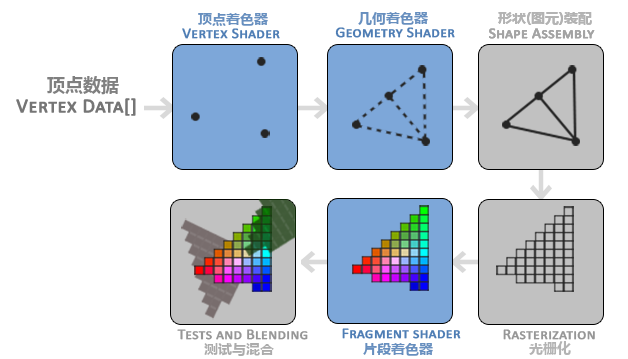
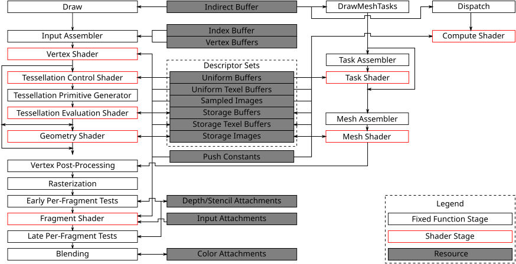

## OpenGL

**渲染管线（Rendering Pipeline）**是 OpenGL 在渲染物体时所执行的一系列步骤。本文将从宏观层面介绍该管线中的各个步骤，下图概括了这一流程中的主要阶段及其关系：


_OpenGL 渲染管线框图_

图中概括了 OpenGL 渲染管线的主要阶段：Vertex Input、Vertex Processing、Vertex Post-Processing、Rasterization、Fragment Shader 和 Per-Sample Processing。紫色框表示可编程着色器阶段，绿色框表示固定功能阶段。

细分控制着色器（Tessellation Control Shader）、细分求值着色器（Tessellation Evaluation Shader）和几何着色器（Geometry Shader）均为可选阶段。变换反馈（Transform Feedback）可在顶点处理后捕获图元数据，但并非进入光栅化的必经阶段。满足条件时，深度和模板测试可在片段着色器执行前进行；具体时机取决于着色器行为和实现。

### Vertex Processing

顶点处理（[Vertex Processing](https://www.khronos.org/opengl/wiki/Vertex_Processing)）负责执行顶点相关的可编程处理，并将结果传递给顶点后处理阶段。处理从顶点着色器开始；根据管线配置，还可以依次经过细分阶段和几何着色器。细分阶段仅用于以 `GL_PATCHES` 绘制的图元，几何着色器则处理完整图元。

顶点着色器可读取若干内置输入变量，例如 `gl_VertexID` 和 `gl_InstanceID`。GLSL 4.60 还定义了 `gl_DrawID`、`gl_BaseVertex` 和 `gl_BaseInstance`。这些变量由 GLSL 预先定义，无须在着色器中自行声明。`gl_VertexID` 表示当前顶点的索引；对于带基础顶点偏移的索引绘制，其值包含该偏移。`gl_InstanceID` 表示当前实例的索引，从 0 开始，且不包含基础实例偏移。`gl_DrawID` 表示多绘制命令中当前绘制项的零基索引，普通绘制时为 0；`gl_BaseVertex` 和 `gl_BaseInstance` 分别表示当前绘制命令指定的基础顶点和基础实例偏移，未指定时为 0。

顶点着色器的输出内置变量包括预定义接口块 `gl_PerVertex` 中的 `gl_Position`、`gl_PointSize` 和 `gl_ClipDistance[]`。其中，`gl_Position` 用于输出顶点的裁切空间位置，供后续阶段处理。

#### Vertex Shader

顶点着色器（Vertex Shader）是可编程渲染管线中必需的着色器阶段。绘制命令处理顶点时，OpenGL 会对顶点执行顶点着色器。其典型用途包括变换顶点位置、生成供后续阶段使用的数据，以及执行逐顶点光照。

顶点着色器通常从顶点属性中读取数据，并将裁切空间位置写入 `gl_Position`。它也可以输出用户自定义变量：若后续还有着色器阶段，这些变量可作为该阶段的输入；否则，光栅化阶段会根据插值限定符对其进行插值，供片段着色器读取。

#### Tessellation

细分（Tessellation）是可选的顶点处理阶段，可将一个由控制顶点定义的图元细分为更小的图元。该阶段由细分控制着色器（可选）、固定功能的细分原语生成器和细分求值着色器组成；细分求值着色器是启用细分阶段所必需的。

细分控制着色器（Tessellation Control Shader，TCS）处理输入图元的控制顶点，并输出供后续阶段使用的控制顶点及细分级别。细分原语生成器根据细分级别和细分模式生成图元及其参数化坐标。

细分求值着色器（Tessellation Evaluation Shader，TES）读取控制顶点和细分原语生成器提供的坐标，为生成的顶点计算位置及其他属性。它常用于地形或曲面细分，也可用于实现位移效果。

使用细分阶段时，必须启用 TES；TCS 则可以省略。省略 TCS 时，顶点着色器的输出直接作为控制顶点传递给细分原语生成器和 TES。启用 TCS 时，处理顺序为 TCS、细分原语生成器、TES。

#### Geometry Shader

几何着色器（Geometry Shader）是可选的顶点处理阶段。它以一个完整图元及其顶点为输入，并可输出零个、一个或多个图元。因此，几何着色器既可以丢弃输入图元，也可以改变图元拓扑或生成额外图元。

几何着色器可用于逐图元处理、生成额外几何体，以及配合多视口功能进行立方体贴图渲染。其输出随后进入顶点后处理阶段。

### Vertex Post-Processing

在顶点处理阶段之后，顶点还要经过一系列固定函数处理步骤，包括图元装配、图元裁切、透视除和视口变换等，这些步骤统称为顶点后处理（[Vertex Post-Processing](https://www.khronos.org/opengl/wiki/Vertex_Post-Processing)）。这里我们重点关注顶点后处理中的图元裁切（[Clipping](https://www.khronos.org/opengl/wiki/Vertex_Post-Processing#Clipping)）、透视除（[Perspective Divide](https://www.khronos.org/opengl/wiki/Vertex_Post-Processing#Perspective_divide)）和视口变换（[Viewport Transform](https://www.khronos.org/opengl/wiki/Vertex_Post-Processing#Viewport_transform)）。首先顶点着色器有如下的预定义输出：

```glsl
out gl_PerVertex
{
  vec4 gl_Position;
  float gl_PointSize;
  float gl_ClipDistance[];
};
```

其中，gl_Position 是当前顶点在裁切空间中的输出位置。

#### Primitive Assembly

顶点处理阶段输出的顶点会被组成图元。图元装配（Primitive Assembly）根据绘制命令指定的绘制模式，将顶点组合为点、线、三角形等图元。

图元装配完成后，图元进入后续处理：先进行裁切，再经过透视除和视口变换，之后才进入光栅化。

#### Clipping

裁切阶段会根据裁切体对图元进行裁剪，在裁切体内的被保留下来，在裁切体之外的会被裁剪丢掉，与裁切体相交的图元可能被裁剪并生成新的顶点。每个顶点的裁切空间位置来自顶点处理阶段最后一个启用的着色器阶段所写入的 `gl_Position`。在默认的 `GL_NEGATIVE_ONE_TO_ONE` 深度模式下，裁切体满足：

$$
-w_{clip} \leqslant x_{clip} \leqslant w_{clip}
$$

$$
-w_{clip} \leqslant y_{clip} \leqslant w_{clip}
$$

$$
-w_{clip} \leqslant z_{clip} \leqslant w_{clip}
$$

若通过 `glClipControl` 选择 `GL_ZERO_TO_ONE` 深度模式，则深度方向的范围变为 $0 \leqslant z_{clip} \leqslant w_{clip}$。启用深度钳制（[Depth Clamping](https://www.khronos.org/opengl/wiki/Vertex_Post-Processing#Depth_clamping)）后，近、远裁切平面不再裁切图元，而是将深度值钳制到相应范围内。着色器还可通过 `gl_ClipDistance[]` 指定用户裁切距离。

#### Perspective divide

未被裁剪掉的顶点通过下面公式可将其在裁切空间位置转换为归一化设备坐标（NDC）：

$$
\begin{pmatrix}
x_{ndc} \\
y_{ndc} \\
z_{ndc} \\
\end{pmatrix}
=
\begin{pmatrix}
\frac{x_{clip}}{w_{clip}} \\
\\
\frac{y_{clip}}{w_{clip}} \\
\\
\frac{z_{clip}}{w_{clip}} \\
\end{pmatrix}
$$

经过透视除后，在默认的 `GL_NEGATIVE_ONE_TO_ONE` 深度模式下，归一化设备坐标分量 $x_{ndc}$、$y_{ndc}$ 和 $z_{ndc}$ 均位于 $[-1,1]$ 范围内；使用 `GL_ZERO_TO_ONE` 深度模式时，$x_{ndc}$、$y_{ndc}$ 位于 $[-1,1]$，而 $z_{ndc}$ 位于 $[0,1]$。

#### Viewport Transform

视口变换定义了从 NDC 空间到窗口空间的变换，将顶点的 NDC 坐标映射到窗口坐标。给定视口参数，我们可以通过下面的方程计算窗口空间坐标（适用于默认的左下角坐标原点和 `GL_NEGATIVE_ONE_TO_ONE` 深度模式）：

$$
\begin{pmatrix}
x_{wnd} \\
y_{wnd} \\
z_{wnd} \\
\end{pmatrix}
=
\begin{pmatrix}
\frac{width}{2}x_{ndc} + x + \frac{width}{2} \\
\\
\frac{height}{2}y_{ndc} + y + \frac{height}{2} \\
\\
\frac{farVal - nearVal}{2}z_{ndc} + \frac{farVal + nearVal}{2}
\end{pmatrix}
=
\begin{pmatrix}
x + \frac{x_{ndc} + 1}{2} width \\
\\
y + \frac{y_{ndc} + 1}{2} height \\
\\
\frac{farVal - nearVal}{2}z_{ndc} + \frac{farVal + nearVal}{2}
\end{pmatrix}
$$

若通过 `glClipControl` 将原点设为 `GL_UPPER_LEFT`，$y$ 方向的映射会反转；若深度模式设为 `GL_ZERO_TO_ONE`，则深度映射公式改为 $z_{wnd} = nearVal + (farVal - nearVal)z_{ndc}$。其中，$x$、$y$、$width$ 和 $height$ 由 `glViewport` 指定，$nearVal$ 和 $farVal$ 由 `glDepthRange` 指定：

```c
// set the viewport
// (x, y) Specify the lower left corner of the viewport rectangle, in pixels. The initial value is (0,0).
// (width, height) Specify the width and height of the viewport.
void glViewport(GLint x​, GLint y​, GLsizei width​, GLsizei height​);

// specify mapping of depth values from normalized device coordinates to window coordinates
// nearVal​ Specifies the mapping of the near clipping plane to window coordinates. The initial value is 0.
// farVal​ Specifies the mapping of the far clipping plane to window coordinates. The initial value is 1.
void glDepthRange(GLdouble nearVal​, GLdouble farVal​);

void glDepthRangef(GLfloat nearVal​, GLfloat farVal​);
```

下面推导一下窗口空间坐标的范围，我们知道，默认坐标原点位于左下角，且 $x_{ndc}$ 和 $y_{ndc}$ 均位于 $[-1,1]$ 区间内，那么：

$$ 
(x_{ndc} + 1) \in [0.0, 2.0], \quad (y_{ndc} + 1) \in [0.0, 2.0]  
$$

继而：

$$
\frac{x_{ndc} + 1}{2} \in [0.0, 1.0], \quad \frac{y_{ndc} + 1}{2} \in [0.0, 1.0] \\
$$

进而：

$$
(\frac{x_{ndc} + 1}{2}) width \in [0.0,\ width], \quad (\frac{y_{ndc} + 1}{2}) height \in [0.0,\ height​] \\
$$

当视口左下角坐标原点的 $x$ 和 $y$ 分量都有值时：

$$
x + (\frac{x_{ndc} + 1}{2}) width \ \in \ [x, x + width], \quad y + (\frac{y_{ndc} + 1}{2}) height \ \in \ [y, y + height​] \\
$$

即有 $x_{wnd} \in [x, x + width]$，$y_{wnd} \in [y, y + height​]$。当 $x=0$，$y=0$ 时，则有 $x_{wnd} \in [0, width]$，$y_{wnd} \in [0, height]$。

在默认深度模式下，我们还知道 $z_{ndc}$ 也位于 $[-1,1]$。当 $z_{ndc} = -1$ 时：

$$
\begin{aligned}
z_{wnd} &= \frac{farVal - nearVal}{2}z_{ndc} + \frac{farVal + nearVal}{2}  \\
        &= \frac{-farVal + nearVal}{2} + \frac{farVal + nearVal}{2} \\
        &= \frac{-farVal}{2} + \frac{nearVal}{2} + \frac{farVal}{2} + \frac{nearVal}{2} \\
        &= nearVal
\end{aligned}
$$

当 $z_{ndc} = 1.0$ 时：

$$
\begin{aligned}
z_{wnd} &= \frac{farVal - nearVal}{2}z_{ndc} + \frac{farVal + nearVal}{2}  \\
        &= \frac{farVal - nearVal}{2} + \frac{farVal + nearVal}{2} \\
        &= \frac{farVal}{2} - \frac{nearVal}{2} + \frac{farVal}{2} + \frac{nearVal}{2} \\
        &= farVal
\end{aligned}
$$

因此，可知 $z_{wnd}$ 位于 $[nearVal, farVal]$ 区间内。

#### Face Culling

面剔除（[Face Culling](https://www.khronos.org/opengl/wiki/Face_Culling)）根据三角形投影到窗口坐标后的顶点绕序方向判定其正反面，并按设置丢弃相应三角形。对于封闭物体，背向观察者的表面通常不可见，因此启用背面剔除可以避免光栅化这些三角形。

面剔除默认处于禁用状态，可通过下列函数启用或禁用：

```c
glEnable(GL_CULL_FACE);
glDisable(GL_CULL_FACE);
```

`glFrontFace` 用于指定哪种绕序方向表示正面：

```c
void glFrontFace(GLenum mode);
```

`mode` 可设置为：

- `GL_CCW`：逆时针绕序的三角形为正面，这是初始设置；
- `GL_CW`：顺时针绕序的三角形为正面。

正反面判定依据三角形在窗口坐标中的投影方向，而不是直接依据建模坐标中的顶点顺序；模型变换也可能改变最终的绕序方向。

`glCullFace` 用于指定剔除正面还是背面：

```c
void glCullFace(GLenum mode);
```

`mode` 可设置为：

- `GL_BACK`：剔除背面，这是面剔除启用后的初始设置；
- `GL_FRONT`：剔除正面；
- `GL_FRONT_AND_BACK`：同时剔除正面和背面，此时不会为三角形生成片段。

典型的背面剔除配置如下：

```c
glEnable(GL_CULL_FACE);
glFrontFace(GL_CCW);
glCullFace(GL_BACK);
```

若网格外表面经变换后呈逆时针绕序，并将 `GL_CCW` 设为正面，则配合背面剔除可保留朝向观察者的三角形。

面剔除发生在光栅化之前，因此被剔除的三角形不会产生片段，也不会执行片段着色器。点图元和线图元没有正反面，不受面剔除影响。

### Rasterization

光栅化（[Rasterization](https://www.khronos.org/opengl/wiki/Rendering_Pipeline_Overview#Rasterization)）是将经过顶点后处理的图元转换为离散片段（Fragment）的过程。光栅化器根据图元在窗口空间中的位置和形状，确定其覆盖范围，并为生成的片段计算插值数据。

光栅化生成的片段随后进入片段着色器，但片段着色器不一定会对每个片段执行：例如，提前执行的深度或模板测试可能使片段在着色前被丢弃。

### Fragment Shader

片段着色器（[Fragment Shader](https://www.khronos.org/opengl/wiki/Fragment_Shader)）是光栅化后的可编程阶段。它可以读取插值后的输入、纹理及其他着色器资源，并输出颜色、深度或样本遮罩等数据。

#### Inputs

片段着色器有下列内置输入变量：

```glsl
in vec4 gl_FragCoord;
in bool gl_FrontFacing;
in vec2 gl_PointCoord;
```

`gl_FragCoord` 
: 片段在窗口空间中的位置，分量依次为 $(x, y, z, w)$。其中，$x$ 和 $y$ 是窗口坐标；$z$ 是深度值，若片段着色器没有写入 `gl_FragDepth`，该值将作为片段深度供后续深度操作使用；$w$ 是 $1/w_{clip}$，这里 $w_{clip}$ 是插值后的裁切空间顶点位置的 $w$ 分量。

`gl_FrontFacing` 
: 片段所属图元是否为正面。对三角形而言，该值由图元的窗口空间绕序及 `glFrontFace` 状态决定；点和线图元的该值为 `true`。可据此对正面和背面执行不同处理。

`gl_PointCoord` 
: 点图元片段在点覆盖区域内的二维坐标。该变量仅对点图元产生的片段有意义，其坐标原点方向可通过 `GL_POINT_SPRITE_COORD_ORIGIN` 状态设置。

除内置变量外，片段着色器还可接收最后一个启用的顶点处理阶段着色器输出的用户自定义变量。声明这些输入时，可指定插值限定符：

```glsl
smooth in vec4 vColor;
flat in int vPrimitiveType;
noperspective in vec2 vTexCoord;
```

其中，`smooth` 表示透视校正插值（默认方式），`noperspective` 表示窗口空间中的线性插值，`flat` 表示不插值，直接采用图元引发顶点（provoking vertex）的值。

#### Outputs

片段着色器可以使用如下内置输出变量：

```glsl
out float gl_FragDepth;
out int gl_SampleMask[];
```

`gl_FragDepth` 
: 用于指定片段深度。若片段着色器未写入该变量，则使用光栅化产生的深度值 `gl_FragCoord.z`。如果着色器静态写入 `gl_FragDepth`，就必须确保所有可能执行到的路径都为其赋值；写入该变量也可能限制深度测试的提前执行。

`gl_SampleMask` 
: 用于控制片段覆盖的样本中哪些可继续处理：对应位为 1 表示保留该样本，为 0 表示屏蔽该样本。若着色器未写入此变量，则不会通过该输出进一步修改样本遮罩。

片段着色器还可声明如下用户自定义输出，用户可通过布局限定符将多个输出变量绑定到帧缓冲区的多个颜色附件，例如：

```glsl
layout(location = 0) out vec4 fragColor;
layout(location = 1) out vec4 fragNormal;
```

片段着色器可使用 `discard` 关键字丢弃当前片段：

```glsl
if (alpha < 0.1)
{
    discard;
}
```

`discard` 会丢弃当前片段，使其不再产生颜色输出或进入后续常规逐样本处理。片段着色器中的分支和丢弃操作也可能影响性能。

### Per-Sample Processing

逐样本处理（[Per-Sample Processing](https://www.khronos.org/opengl/wiki/Per-Sample_Processing)）是片段着色器执行之后，按像素样本对片段进行测试、更新及写入帧缓冲区的一组固定功能操作。启用多重采样时，这些操作通常针对每个像素样本分别执行；未启用多重采样时，每个片段对应一个像素样本。

片段经过逐样本处理后，只有通过全部启用测试且具备有效像素所有权的片段，才会更新帧缓冲区中的颜色、深度或模板值。

#### Pixel Ownership Test

像素所有权测试（Pixel Ownership Test）确定当前像素是否属于 OpenGL 上下文所对应的窗口。由其他窗口或系统覆盖区域占用的像素不允许被写入帧缓冲区。

#### Scissor Test

裁剪测试（Scissor Test）要求片段位于由 glScissor 定义的矩形区域内：

```c
void glScissor(
    GLint x,
    GLint y,
    GLsizei width,
    GLsizei height
);
```

裁剪矩形的坐标仍使用窗口坐标，其原点位于窗口左下角。裁剪测试可通过下列语句启用或禁用：

```c
glEnable(GL_SCISSOR_TEST);
glDisable(GL_SCISSOR_TEST);
```

裁剪测试适合限制渲染区域，例如只更新屏幕中的局部区域。

#### Stencil Test

模板测试（Stencil Test）使用模板缓冲区中的模板值决定片段是否能够继续处理。模板测试由 glStencilFunc 指定比较条件，由 glStencilOp 根据模板测试和深度测试的结果指定对模板缓冲区中的值执行何种操作：

```c
void glStencilFunc(
    GLenum func,
    GLint ref,
    GLuint mask
);

void glStencilOp(
    GLenum sfail,
    GLenum dpfail,
    GLenum dppass
);
```

其中，sfail 表示模板测试失败时的操作，dpfail 表示模板测试通过但深度测试失败时的操作，dppass 表示模板测试和深度测试都通过时的操作。模板缓冲区可用于限定后续绘制范围、绘制轮廓或实现遮罩等效果。

#### Depth Test

深度测试（Depth Test）比较片段深度与深度缓冲区中对应像素或样本保存的深度值。比较函数可通过 glDepthFunc 指定：

```c
void glDepthFunc(GLenum func);
```

常见设置包括 GL_LESS 和 GL_LEQUAL。若片段通过深度测试，深度值可写入深度缓冲区，该行为可由 glDepthMask 控制：

```c
glDepthMask(GL_TRUE);
glDepthMask(GL_FALSE);
```

深度测试使新片段不会覆盖深度更近的已有片段，从而解决不同图元在屏幕上的可见性问题。

#### Multisample Operations

多重采样（Multisampling）所做的是将单一的采样点变为多个采样点。多重采样不再使用像素中心的单一采样点，取而代之的是以特定模式排列的多个子采样点，用这些子采样点来确定图元对像素的覆盖范围，以降低几何边缘锯齿。

#### Blending

混合（Blending）将片段着色器或片段分发得到的颜色与帧缓冲区中已有颜色按指定公式合成。混合通常使用源因子和目标因子的线性组合：

$$
\mathbf{C}_{out}
=
\mathbf{C}_{source}\mathbf{F}_{source}
+
\mathbf{C}_{destination}\mathbf{F}_{destination}
$$

其中，源因子和目标因子由 glBlendFunc 或 glBlendFuncSeparate 指定。混合可由 glEnable(GL_BLEND) 启用，并可通过 glBlendEquation 指定加法、减法或其他混合方程。

#### Dithering

抖动（[Dithering](https://wikis.khronos.org/opengl/Per-Sample_Processing#Dithering)）用于降低有限位数帧缓冲区保存颜色时产生的量化误差。相邻像素使用微小差异的量化模式，可以让连续色阶在视觉上表现得更加平滑，减少明显的色带。

抖动默认可能处于启用状态，可通过下列函数启用或禁用：

```c
glEnable(GL_DITHER);
glDisable(GL_DITHER);
```

抖动只影响帧缓冲区能够表示的颜色精度；它不能增加帧缓冲区的实际颜色位数，也不能校正分辨率不足或原始着色器计算中的误差。

#### Logic Operations

逻辑操作（[Logic operations](https://wikis.khronos.org/opengl/Per-Sample_Processing#Logic_operations)）可以在片段颜色和帧缓冲区中已有的颜色之间执行逐位布尔运算。逻辑操作可通过 glLogicOp 指定运算类型：

```c
void glLogicOp(GLenum opcode);
```

常见操作包括 GL_COPY、GL_XOR、GL_AND 和 GL_OR 等。启用逻辑操作后，片段颜色和帧缓冲区已有颜色通过逻辑运算得到最终写入值，而不是执行混合：

```c
glEnable(GL_COLOR_LOGIC_OP);
glDisable(GL_COLOR_LOGIC_OP);
```

颜色混合和颜色逻辑操作不能同时对同一帧缓冲区生效；启用一种操作时应注意禁用另一种。逻辑操作主要适用于支持逐位颜色运算的整数或位图形式帧缓冲区，而浮点帧缓冲区通常应使用混合。

逻辑操作只处理片段的颜色写入，不会改变深度或模板测试。它也不会影响片段是否通过逐样本测试。

#### Write Mask

写入掩码（[Write mask](https://wikis.khronos.org/opengl/Per-Sample_Processing#Write_mask)）用于控制片段通过逐样本测试后，帧缓冲区中哪些分量允许被修改。

`glColorMask` 设置颜色写入掩码，分别控制红、绿、蓝和 Alpha 通道是否写入；该掩码对所有绘制缓冲区生效：

```c
void glColorMask(
    GLboolean red,
    GLboolean green,
    GLboolean blue,
    GLboolean alpha
);
```

将某个参数设为 `GL_FALSE` 时，对应通道会保留帧缓冲区中的原值，而不会被本次绘制更新。例如，下面的配置允许写入 RGB，但不更新 Alpha：

```c
glColorMask(GL_TRUE, GL_TRUE, GL_TRUE, GL_FALSE);
```

如果使用多个绘制缓冲区，并希望为它们设置不同的颜色写入掩码，可使用 `glColorMaski`。它通过第一个参数指定绘制缓冲区索引，后续参数分别设置该缓冲区的 RGBA 通道掩码。例如：

```c
glColorMaski(1, GL_TRUE, GL_TRUE, GL_TRUE, GL_FALSE);
```

深度和模板缓冲区也可分别使用写入掩码：

```c
glDepthMask(GL_TRUE);
glDepthMask(GL_FALSE);

glStencilMask(mask);
glStencilMaskSeparate(face, mask);
```

GL_TRUE 表示允许深度值写入深度缓冲区，GL_FALSE 表示禁止写入。模板掩码控制模板测试和模板操作能够修改模板缓冲区中的哪些位。写入掩码只阻止帧缓冲区更新，不会阻止片段着色器执行或深度、模板测试本身。

片段通过所有测试后，其颜色被写入帧缓冲区，深度和模板也可分别写入对应缓冲区。

### Others

另外，这里引用 LearnOpenGL 中的一幅 OpenGL 渲染管线执行流程（简化版）图帮助加深理解：



## Vulkan

Vulkan 图形管线执行流程：



## Conclusion

可以看到，图元装配是按照指定的拓扑将一个类似于 glDrawElements 这样的绘制指令涉及的一系列顶点组装成为目标形状的操作，OpenGL 的输入装配是在顶点着色器和片段着色器之间，而 Vulkan 的输入装配是在顶点着色器之前；OpenGL 的模版与深度测试默认是在【测试与混合】阶段执行，在后期 OpenGL 还加入了 Early Fragment Test 特性，允许模版与深度等测试在片段着色器之前执行。Vulkan 在片段着色器前后有一个 Early Per-Fragment Test 和 Late Per-Fragment Test，可以指定模版与深度测试在哪个阶段执行，默认是在 Late Per-Fragment Test 阶段执行。


## References
>
> * [OpenGL Rendering Pipeline Overview](https://www.khronos.org/opengl/wiki/Rendering_Pipeline_Overview)
>
> * [Vulkan Rendering Pipeline Overview](https://docs.vulkan.org/spec/latest/chapters/pipelines.html)
>
> * [OpenGL Vertex Shader](https://www.khronos.org/opengl/wiki/Vertex_Shader)
>
> * [OpenGL Fragment Shader](https://www.khronos.org/opengl/wiki/Fragment_Shader)
>
> * [OpenGL® 4.5 Reference Pages](https://registry.khronos.org/OpenGL-Refpages/gl4/)
