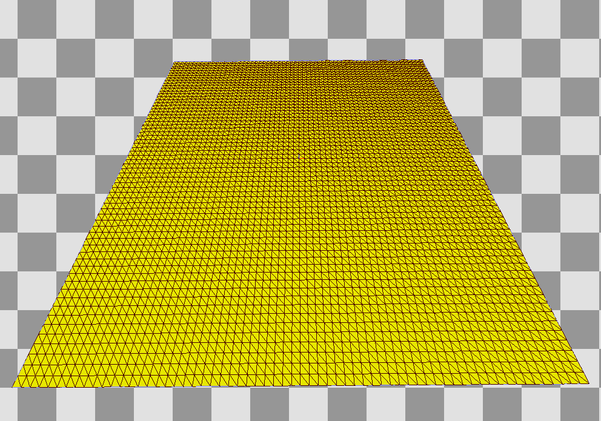
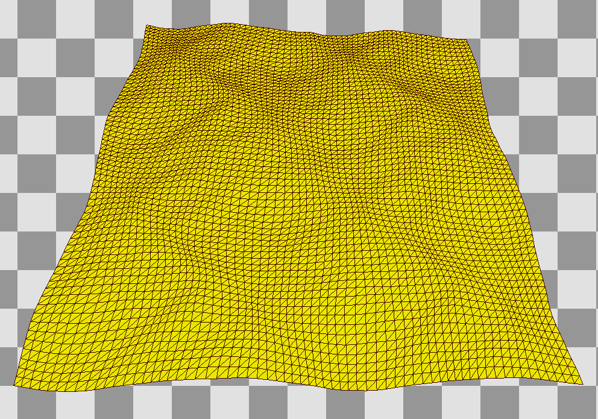
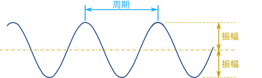
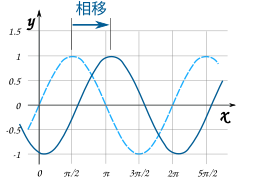
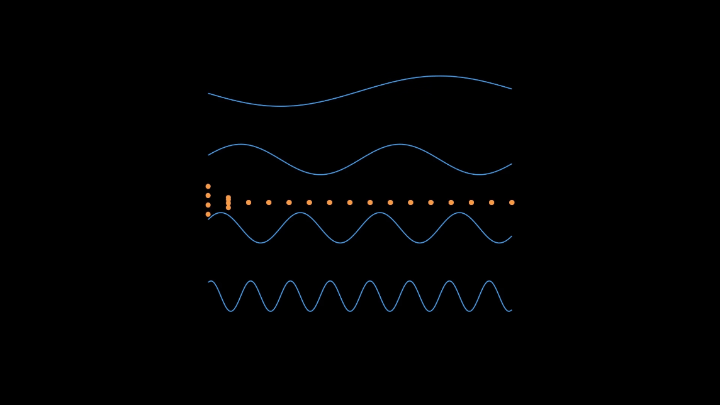

## 1. 海面高度场与离散表示

首先，约定 $y$ 轴正方向表示垂直向上，$xz$ 平面表示水平面，那么海水表面就是一个连续的高度场，可表示为：

$$
y = H(x, z, t)
$$

其中，$t$ 是时间变量，因为水面在不同时刻是动态变化的，所以它也是一个与时间有关的函数。当然，在计算机中我们需要离散的表示这一高度场。即就是建立一个网格平面，计算出网格平面中每个 $(x, z)$ 坐标处顶点的 $y$ 值。


_无高度场的网格面_


_带有高度场的网格面_

如果将坐标 $(x, z)$ 用位置向量 $\vec{p}$ 代替，高度场表示形式变为：

$$
\begin{aligned}
y
&= H(x, z, t) \\
&= H(\vec{p}, t)
\end{aligned}
$$

可以把高度场看做一种信号，信号通常在**时间域**中给出：一个把时间映射到振幅的函数。傅里叶分析允许我们将时间域上信号表示成不同频率的相移正弦曲线的加权叠加。

## 2. 从正弦波到二维波形

首先来了解一下一维正弦函数，有如下形式：

$$
A \sin(k x + \omega t + \phi)
$$

其中，$A$ 是振幅。$k$ 是波数或空间频率，它决定了波在空间中单位长度内振动的次数，具体来说，$k$ 的大小与波长 $\lambda$ 成反比，即$k = \frac{2 \pi}{\lambda} $。$x$ 是空间位置。$\omega$ 是角频率，表示振动的快慢。$t$ 是时间，没有 $t$ 正弦函数就是一个静止的曲线，加上 $t$ 可使曲线随时间动起来。$\phi$ 是初始相位。





一维正弦函数用来描述一条曲线，而二维正弦函数则可以用来描述一个曲面：

$$
A \sin(k_x x + k_z z + \omega t + \phi)
$$

其中，$(k_x, k_z)$ 构成波矢向量 $\vec{k}$：它的模 $k = \lvert \vec{k} \rvert$ 决定空间频率（与波长成反比），方向则决定波的朝向。$k_x x + k_z z$ 可写成向量 $\vec{k}$ 和 向量 $\vec{p}$ 点积乘的形式，那么上式可写成如下形式：

$$
A \sin(\vec{k} \cdot \vec{p} + \omega t + \phi)
$$


## 3. 基于傅里叶叠加的海浪模型

傅里叶分析允许我们将时间域上信号表示成不同频率的相移正弦曲线的加权叠加。一个复杂波形可以看做由多个不同的简单波形叠加而成。



根据欧拉公式 $e^{ix} = \cos x + i \sin x$，令简单子波的相位为 $\theta = \vec{k} \cdot \vec{p} + \omega t + \phi$，则它的复数形式可写为：

$$
A \big( \cos \theta + i \sin \theta \big)
$$

因此，该子波也可简写为：

$$
A e^{i\theta} = A e^{i(\vec{k} \cdot \vec{p} + \omega t + \phi)}
$$

对上式做变化，可变成：

$$
A e^{i(\omega t + \phi)} e^{i(\vec{k} \cdot \vec{p})}
$$

令 $h = A e^{i(\omega t + \phi)}$，上式可简写成：

$$
h e^{i(\vec{k} \cdot \vec{p})}
$$

这就是一个简单子波形的复指数形式。引入复指数是为了便于运算，单条波对应的实际波高取复数表达式的实部即可。模拟海浪时，需要根据海浪特性确定 $h$ 中 $A$、$\omega$ 和 $\phi$ 的取值。在本文采用的静水、各向同性水体模型中，角频率 $\omega$ 由色散关系确定，只取决于波数大小 $k = \lvert \vec{k} \rvert$；振幅 $A$ 由半经验的海浪功率谱（例如 Phillips 谱）确定，是波矢 $\vec{k}$ 的函数；初相 $\phi$ 则由随机振幅给出（见下文）。因此，$h$ 是波矢 $\vec{k}$ 和时间 $t$ 的函数，海浪子波形可写为：

$$
h(\vec{k}, t) e^{i(\vec{k} \cdot \vec{p})}
$$

那么，$\vec{p}$ 点处 $t$ 时刻的 $y$ 值，可由多个这种形式的具有不同 $\vec{k}$ 值的简单子波形叠加求得

$$
y = H(\vec{p}, t) = \sum_{\vec{k} } h(\vec{k},t)e^{ i (\vec{k} \cdot \vec{p})}
$$

有了这个描述高度场的函数，剩下的就是确定 $h(\vec{k}, t)$ 中的 $A$ 、$\omega$ 如何计算。大多数海浪是重力波（即风浪），作用于水的干扰力是风，而恢复力是重力。首先来看 $\omega$，$\omega$ 是一种色散关系（dispersion relationship）。色散关系是一个物理学中的概念，特别是在波动理论中，它描述了波的传播速度与波的频率或波长之间的关系。在海洋学和水波理论中，色散关系描述了波浪在介质（如水）中传播时，其速度如何随波长变化。在深水区，有如下的色散关系：

$$
\omega(k) = \sqrt{g k}
$$

其中，$g$ 是重力加速度，一般是 $9.8 m/sec^2$。$k$ 是向量 $\vec{k}$ 的大小或长度。在浅水区，水底海床对波浪会有阻滞作用，其色散关系是：

$$
\omega(k) = \sqrt{g k \tanh(kD)}
$$

其中，$D$ 是水深。如果水深足够大，$\tanh$ 函数就会趋近于 1，这个浅水区色散关系就会变得和深水区色散关系相同。对于波长大约在 1cm 或更小的小波而言，色散关系中有一个额外的项：

$$
\omega(k) = \sqrt{g k (1 + k^2 \ell^2)}
$$

其中 $\ell = \sqrt{\gamma / (\rho g)}$ 是只与液体性质有关的长度尺度（水的毛细长度约为 $2.7\ \text{mm}$），$\gamma$ 是表面张力系数，$\rho$ 是水的密度。当波长远大于毛细波长时 $\ell$ 的影响可以忽略，上式退化为深水色散关系。接下来来看振幅：

$$
A(\vec{k}) = \frac{1}{\sqrt{2}}(\xi_r + i \xi_i) \sqrt{P_h(\vec{k})}
$$

这里 $\xi_r$ 和 $\xi_i$ 是高斯随机数生成器的普通独立抽样，高斯分布的随机数往往更符合海浪的实验数据。$P_h(\vec{k})$ 是半经验的波浪功率谱（power spectrum），它给出每个波矢 $\vec{k}$ 上波动的能量密度。

系数 $\frac{1}{\sqrt{2}}$ 的来历也不难看出：$\xi_r$、$\xi_i$ 是两个独立的标准正态随机数，$\lvert \xi_r + i \xi_i \rvert^2$ 的期望为 2，于是

$$
\mathbb{E}\big[ \lvert A(\vec{k}) \rvert^2 \big] = \frac{1}{2} \cdot 2 \cdot P_h(\vec{k}) = P_h(\vec{k})
$$

即振幅的期望功率恰好等于功率谱在 $\vec{k}$ 处的取值。在充分开放的海域，适合风浪波（比毛细波更大的波）的波谱是 Phillips 波谱：

$$
P_h(\vec{k}) = C \frac{e^{\frac{-1}{(k L_{\text{wind}})^2}}}{k^4} \lvert \vec{k} \cdot \vec{d}_{wind} \rvert ^2
$$

这里 $C$ 是一个数值常量，用来整体缩放波浪的幅度；$k$ 是向量 $\vec{k}$ 的大小或长度。$L_{\text{wind}} = V^2 / g$ 是在一个速度为 $V$ 的持续风中可能升起的最大的波长，$g$ 是重力加速度。$\vec d_{wind}$ 是表示风向的**单位向量**（$\lvert \vec d_{wind} \rvert = 1$），这一点需要注意：若传入未归一化的风向，谱值会整体差一个 $\lvert \vec d_{wind} \rvert^2$ 因子。Phillips 波谱中的余弦因子 $\lvert \vec{k} \cdot \vec d_{wind} \rvert ^2$ 消除了垂直于风向移动的波：只有当波矢 $\vec{k}$ 平行于风向时该因子才取到最大值，$\vec{k}$ 越偏离风向，谱值越小。

到这里我们就相继确定了 $\omega(k)$ 和 $A(\vec{k})$，现在再来回头看看 $h(\vec{k}, t)$。给定一个色散关系 $\omega(k)$，在 $t$ 时刻的傅里叶振幅可实现为：

$$
h(\vec{k}, t) = A(\vec{k}) e^{i \omega(k) t} + A^*(-\vec{k}) e^{-i \omega(k) t}
$$

> 随机初相是让海面显得自然、不重复的关键，但它已经包含在随机振幅 $A(\vec{k})$ 中：当 $\xi_r$ 和 $\xi_i$ 是独立的标准正态随机数时，复数 $\xi_r + i \xi_i$ 的相位服从均匀分布，因此这里不再单独列出 $\phi$。
{: .prompt-tip }

式中的第二项 $A^*(-\vec{k}) e^{-i \omega(k) t}$，表示反向波矢 $-\vec{k}$ 处初始振幅的复共轭随时间演化后的贡献。由于本文采用的色散关系只依赖波数大小 $k = \lvert \vec{k} \rvert$，因此 $\omega(-\vec{k}) = \omega(\vec{k})$。将 $\vec{k}$ 替换为 $-\vec{k}$，可得：

$$
h(-\vec{k}, t) = A(-\vec{k}) e^{i \omega(k) t} + A^*(\vec{k}) e^{-i \omega(k) t} = \overline{h(\vec{k}, t)}
$$

因此，频谱 $h(\vec{k}, t)$ 具有**共轭对称性**（Hermitian 对称）。注意，这一对称性来自上述频谱构造以及 $\omega(-\vec{k}) = \omega(\vec{k})$，并不要求初始随机振幅 $A(\vec{k})$ 本身具有共轭对称性。

有了这个对称性，高度场

$$
H(\vec{p}, t) = \sum_{\vec{k}} h(\vec{k}, t) e^{i (\vec{k} \cdot \vec{p})}
$$

就必然是实数：将共轭后的求和变量 $\vec{k}$ 换成 $-\vec{k}$，可得 $H^* = H$。因此，构造共轭对称的频谱后，逆 FFT 得到的高度场为实数；实际计算时只需取数值结果的实部。

## 4. 使用二维 FFT 加速海面计算

假定周期水面的尺寸为 $L_x \times L_z$，采样网格为 $N_x \times N_z$。为简化推导，令 $L_x = L_z = L$、$N_x = N_z = N$，并假设 $N$ 为偶数（通常 $N$ 可取 16 到 2048 之间的值，实际应用中 128 到 512 往往已足够）。

水面在 $x$ 和 $z$ 两个水平方向上都以 $L$ 为周期。在 $x$ 方向上，单个波形分量必须满足 $e^{ik_x(x+L)}=e^{ik_xx}$，因此 $k_xL=n \times 2\pi$，其中 $n$ 为整数；$z$ 方向同理，也必须满足 $e^{ik_z(z+L)}=e^{ik_zz}$，因此 $k_zL=m \times 2\pi$，其中 $m$ 为整数。因此波矢向量 $\vec{k}$ 为：

$$
\vec{k} = (k_x, k_z) = \left(\frac{2\pi n}{L}, \frac{2\pi m}{L}\right) \qquad
n,m \in \left\{-\frac{N}{2},\ldots,\frac{N}{2}-1\right\}.
$$

其中，$(n,m)$ 就是波数网格的索引，分别标记 $x$ 和 $z$ 方向的波数，直观地说，$n$ 和 $m$ 表示波在长度为 $L$ 的周期区域内分别沿 $x$ 和 $z$ 方向变化多少个周期。类似地，用整数索引 $(a,b)$ 标记空间采样网格中的采样点：$a$ 和 $b$ 分别表示采样点在 $x$ 和 $z$ 方向上的序号，取值为 $0,\ldots,N-1$。第 $(a,b)$ 个采样点的位置向量为：

$$
\vec{p} = (x_a,z_b) = \left(\frac{aL}{N},\frac{bL}{N}\right).
$$

将 $\vec{k}$ 与 $\vec{p}$ 代入高度场函数：

$$
\begin{aligned}
H(\vec{p}, t)
&= \sum_{\vec{k}} h(\vec{k}, t) e^{i (\vec{k} \cdot \vec{p})}\\
&= \sum_{n=-N/2}^{N/2-1}\sum_{m=-N/2}^{N/2-1}h(\vec{k},t)e^{i(k_xx_a+k_zz_b)}\\
&= \sum_{n=-N/2}^{N/2-1}\sum_{m=-N/2}^{N/2-1}h(\vec{k},t)e^{2\pi i(na+mb)/N}
\end{aligned}
$$

为了写成 FFT 的数组索引形式，将中心化的波数索引平移到 $0,\ldots,N-1$。定义 $n'$ 和 $m'$：

$$
0 \le n' \lt N
$$

$$
0 \le m' \lt N
$$

于是

$$
n = n' - \frac{N}{2}
$$

$$
m = m' - \frac{N}{2}
$$

代入上式：

$$
\begin{aligned}
H(x_a,z_b,t)
&= \sum_{n'=0}^{N-1}\sum_{m'=0}^{N-1}
h(\vec{k},t)e^{2\pi i((n'-N/2)a+(m'-N/2)b)/N}\\
&= (-1)^{a+b}\sum_{n'=0}^{N-1}\sum_{m'=0}^{N-1}
h(\vec{k},t)e^{2\pi i(n'a+m'b)/N}.
\end{aligned}
$$

其中波矢为

$$
\vec{k} = \left(\frac{2\pi(n'-N/2)}{L},\frac{2\pi(m'-N/2)}{L}\right).
$$

等号右侧的求和是带正指数的二维逆 DFT 求和。若采用常见的归一化定义，

$$
\operatorname{IFFT2}(h)_{a,b}
= \frac{1}{N^2}\sum_{n'=0}^{N-1}\sum_{m'=0}^{N-1}
h(\vec{k},t)e^{2\pi i(n'a+m'b)/N},
$$

则高度场为 $H(x_a,z_b,t)=(-1)^{a+b}N^2\operatorname{IFFT2}(h)_{a,b}$。这里的 $(-1)^{a+b}$ 来自频率索引平移 $N/2$，是只依赖输出网格索引的棋盘格因子。这样一来，就能借助 FFT 在 $O(N^2\log N)$ 的时间内求出整张网格的高度，而不必按原始定义做 $O(N^4)$ 的二重求和。

实现时还要注意频谱数组的下标顺序。FFT 程序通常使用自然顺序：下标 $0,\ldots,N/2-1$ 对应频率 $0,\ldots,N/2-1$，下标 $N/2,\ldots,N-1$ 对应频率 $-N/2,\ldots,-1$。若先将中心化频谱重排为这种自然顺序，再执行逆 FFT，就不需要额外乘棋盘格因子；若直接对上式的中心化数组执行逆 FFT，则需将结果乘以 $(-1)^{a+b}$。两种做法等价。两种情况下，若逆 FFT 自带 $1/N^2$ 归一化，都需再乘 $N^2$ 才与本文的傅里叶级数定义一致。

### 初始化与逐帧更新

综合以上推导，基于 FFT 的海浪模拟可以分为两步：

1. **初始化**（只执行一次）：对每一个波矢 $\vec{k}$，用独立的标准正态随机数 $\xi_r$、$\xi_i$ 与 Phillips 波谱 $P_h(\vec{k})$ 计算初始随机振幅 $A(\vec{k}) = \frac{1}{\sqrt{2}}(\xi_r + i \xi_i) \sqrt{P_h(\vec{k})}$，并预计算色散关系 $\omega(k) = \sqrt{gk}$。

2. **逐帧更新**（每帧执行）：用 $h(\vec{k}, t) = A(\vec{k}) e^{i \omega(k) t} + A^*(-\vec{k}) e^{-i \omega(k) t}$ 更新频谱，再对其做一次二维逆 FFT；根据 FFT 库的归一化约定恢复傅里叶级数的尺度，取实部即可得到当前时刻高度场 $H(x_a, z_b, t)$ 的全部网格点高度。

```c++
// N 为偶数网格边长，L 为水面尺寸，G 为重力加速度
// 数组下标 i 对应的频率为 i（i < N/2）或 i - N（i >= N/2），即 FFT 的自然顺序
auto freq = [N](int i) { return (i < N / 2) ? i : i - N; };

// ---- 初始化：只执行一次 ----
for (int m = 0; m < N; ++m)
for (int n = 0; n < N; ++n) {
    float kx = 2.0f * PI * freq(n) / L;
    float kz = 2.0f * PI * freq(m) / L;
    float k  = std::sqrt(kx * kx + kz * kz);
    h0[n][m]    = {gauss(), gauss()};                  // 两个独立的标准正态随机数
    h0[n][m]   *= std::sqrt(Phillips(kx, kz) / 2.0f);
    omega[n][m] = std::sqrt(G * k);                    // 深水色散关系
}

// ---- 更新：每帧执行 ----
for (int m = 0; m < N; ++m)
for (int n = 0; n < N; ++n) {
    auto e = std::exp(Complex{0.0f, omega[n][m] * t});
    // 共轭项 A*(-k)：-k 对应的数组下标为 (N - n) % N 与 (N - m) % N
    spec[n][m] = h0[n][m] * e
               + std::conj(h0[(N - n) % N][(N - m) % N]) * std::conj(e);
}
IFFT2(spec);                                           // 二维逆 FFT
for (int m = 0; m < N; ++m)
for (int n = 0; n < N; ++n)
    height[n][m] = spec[n][m].real() * N * N;          // 假设 IFFT 含 1/N²；取实部并恢复傅里叶级数尺度
```

若所用 FFT 库的逆变换不带 $1/N^2$ 归一化，则不应再乘 $N^2$。实际代码应按所用库的归一化约定选择其中一种。

### 网格分辨率与 Nyquist 频率

高度场定义在一块 $L \times L$ 的方形网格上，网格间距为 $\Delta = L / N$。每个坐标轴上的波数受 Nyquist 上限约束：

$$
k_{\mathrm{Nyquist}} = \frac{\pi}{\Delta} = \frac{\pi N}{L}, \qquad \lambda_{\mathrm{axis,min}} = \frac{2 \pi}{k_{\mathrm{Nyquist}}} = 2\Delta = \frac{2L}{N}.
$$

- 二维网格可表示的波数区域是 $|k_x|, |k_z| \le k_{\mathrm{Nyquist}}$ 的方形，而不是以 $k_{\mathrm{Nyquist}}$ 为半径的圆。沿坐标轴方向最短可表示波长为 $2\Delta$；方形角落处的径向波数可达 $\sqrt{2}\,k_{\mathrm{Nyquist}}$。
- $\Delta$ 决定网格能表示的最小空间尺度。超出上述方形 Nyquist 区域的频率不能被网格正确表示，会被丢弃或产生混叠，所以 $N$ 不能取得太小。
- $L$ 决定海面的空间重复周期。水面在水平方向上是循环重复的，$L$ 取大一些可以减弱「一眼就看出在平铺」的感觉。
- $N$ 决定计算量。二维逆 FFT 的复杂度是 $O(N^2 \log N)$，$N$ 翻倍时计算量约变为原来的 4 倍多。

离散化时，波数落在方形 Nyquist 区域之外的谱分量无法表示。若实现中另行按径向波数进行圆形截断，才可以说所有 $k > k_{\mathrm{cutoff}}$ 的分量都会被舍弃。实际波高还可通过 Phillips 谱中的常量 $C$ 整体缩放。

### 数值实现中的注意事项

实现时还有几个容易踩的坑：

1. **$\vec{k} = 0$ 处要特判**。$P_h(\vec{k})$ 在 $k \to 0$ 时的极限是 $0$（指数项 $e^{-1/(k L_{\text{wind}})^2}$ 衰减得比任何幂次都快），但直接代入会得到 $0 / 0$ 从而算出 NaN。把 $\vec{k} = 0$ 处的谱值直接置 $0$ 即可，这同时也避免了高度场出现一个常数偏移。

2. **注意 FFT 库的归一化约定**。不少库的逆变换自带 $1/N^2$ 系数，也有不带系数的。若前后搞混，整片海面的波高会整体差 $N^2$ 倍——表现出来就是要么平如镜面，要么高得离谱。

3. **固定随机种子即可复现同一片海**。$\xi_r$、$\xi_i$ 一般在初始化时生成一次即可；如果希望每次运行都得到完全相同的海面（例如离线烘焙法线贴图），在初始化之前固定随机数种子就行。

4. **$t$ 是解析代入的，不需要时间积分**。每一帧只是把新的 $t$ 代进 $e^{\pm i \omega t}$ 重算一次频谱，而不在上一步的结果上做数值积分，因此不会累积误差，也可以任意跳帧（暂停、快进、倒放都行）。

## 5. 交互式海浪演示

下面的演示使用 Phillips 波谱初始化频谱，并在每一帧根据深水色散关系更新 $h(\vec{k}, t)$，再通过二维逆 FFT 生成海面高度场。调整风速、风向、波幅和网格分辨率，观察海浪的变化。

<iframe
  src="/assets/html/ocean-wave/index.html"
  title="基于二维逆 FFT 的交互式海浪模拟"
  loading="lazy"
  style="display: block; width: 100%; height: 690px; border: 0; border-radius: 10px;"
  allow="fullscreen">
</iframe>

## 参考资料
>
> * [振幅、周期、相移和频率 - 数学乐](https://www.shuxuele.com/algebra/amplitude-period-frequency-phase-shift.html)
>
> * [Simulating Ocean Water - J. Tessendorf](https://people.computing.clemson.edu/~jtessen/reports/papers_files/coursenotes2004.pdf)
>
> * [复数 - OI Wiki](https://oi-wiki.org/math/complex/)
>
> * [共轭复数 - wikiwand](https://www.wikiwand.com/zh-cn/%E5%85%B1%E8%BD%AD%E5%A4%8D%E6%95%B0)
