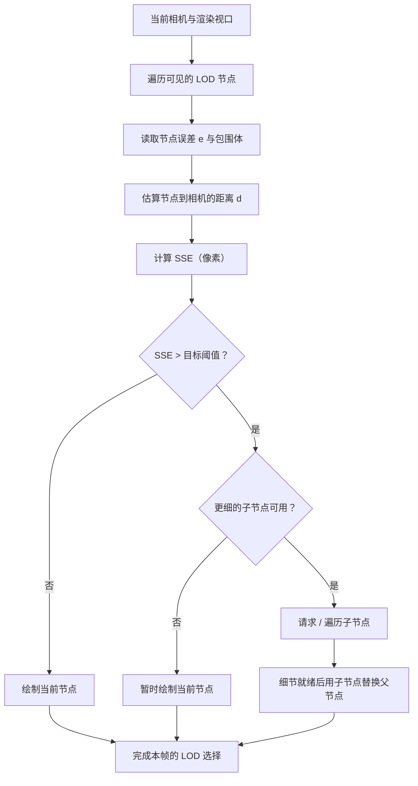

## 1. 概述

渲染大范围地形时，近处地形需要较高精度以避免细节粗糙；远处地形则可适当降低精度，因为其几何误差投影到屏幕后往往难以察觉。若所有地形块都采用最高精度，会产生不必要的三角形开销；若都采用低精度，又会损害近处画质。LOD（Level of Detail）通过为同一对象准备不同精度的模型，并根据观察情况选择合适的层级，以平衡画面质量和渲染开销。

选择层级时，只看物体与相机的距离并不够。不同地形块的几何误差可能不同，而相同的误差在不同视距和视口下也会产生不同的视觉影响。因此，需要衡量当前简化造成的误差投影到屏幕上有多大。**Screen Space Error（SSE，屏幕空间误差）**就是将几何近似误差换算为像素尺度的度量。渲染器根据 SSE 判断是否继续使用当前层级，或切换到更精细的层级。SSE 常用于地形瓦片、网格简化、HLOD 和大场景流式加载。

## 2. 屏幕空间误差的计算

LOD 节点通常保存一个几何误差 $e$，表示当前简化模型相对于更精细参考模型的最大偏差估计。渲染时，SSE 将这个世界空间误差通过当前相机的投影关系换算成屏幕上的像素尺度。它衡量的是简化误差可能造成多大屏幕偏差，并非逐像素比较简化图像与参考图像的结果。下面分别介绍在透视投影和正交投影情况下，从世界空间误差到屏幕空间像素误差的计算过程。

### 透视投影

在透视投影下，物体离相机越远，同样大小的世界空间偏差投影到屏幕上就越小；视口分辨率越高，或纵向视场角越窄，同样的偏差则会占据更多像素。因此，SSE 综合了节点误差、相机距离和投影设置。LOD 系统再将 SSE 与以像素为单位的目标误差阈值比较：SSE 较大时细化节点，SSE 足够小时保留当前层级。

设相机的纵向视场角为 $\theta$，渲染视口高度为 $H$ 像素。透视投影的纵向焦距换算到像素空间后为：

$$
f_{\text{px}} = \frac{H}{2\tan(\theta/2)}
$$

若将几何偏差 $e$ 近似为垂直于视线方向的位移，那么在距相机 $d$ 处，它对应的视角约为 $e/d$（弧度，小角度近似）。再乘以像素焦距 $f_{\text{px}}$，即可得到屏幕空间误差的近似值：

$$
\operatorname{SSE}
\approx \frac{e}{d} \cdot f_{\text{px}}
= \frac{e}{d} \cdot \frac{H}{2\tan(\theta/2)}
\quad \text{pixels}
$$

由公式可知，几何误差 $e$ 或视口高度 $H$ 增大时，SSE 增大；相机距离 $d$ 或纵向视场角 $\theta$ 增大时，SSE 减小。也就是说，更大的模型误差和更高的像素密度会要求更精细的 LOD，而更远的视距和更宽的视野会让同一误差在屏幕上显得更小。公式中的变量和单位如下：

- $e$：当前 LOD 节点相对于更精细参考几何的几何误差估计，单位为世界空间单位（例如米）。通常离线计算，例如对简化网格采样，求采样点到参考几何的最大偏差，或由简化算法给出误差上界，并将结果保存为节点元数据。
- $d$：相机到节点包围球或包围盒的最短欧式距离，单位为世界空间单位（例如米），单位必须与 $e$ 相同。避免只用节点中心距离而低估近处误差。若相机进入包围体附近，应限制距离的最小值或采用其他规则，避免分母接近零导致 SSE 过大。距离估计越近，通常越早细分；估计越远，则可能导致可见细节不足。对于深度范围较大的节点，单个距离和误差值只能提供近似结果。
- $\theta$：相机的纵向视场角（vertical FOV），单位为角度弧度，从相机投影设置读取。
- $H$：实际渲染视口的像素高度，单位为像素（px），从当前渲染视口读取，不一定等于窗口或显示器的高度。
- $f_{\text{px}}$：纵向焦距对应的像素尺度，单位为像素（px）。

假定渲染系统或应用将允许的最大屏幕空间误差设为阈值 $T$，单位为像素（px）。当

$$
\operatorname{SSE}>T
$$ 

时，通常需要继续细化当前 LOD 节点。

### 正交投影

正交投影不会产生透视缩小，因此相机距离不会改变物体的投影尺寸。SSE 可估算为：

$$
\operatorname{SSE}_{\text{ortho}} \approx e \cdot \frac{H}{S} \quad \text{pixels}
$$

其中，$S$ 表示正交视野垂直方向覆盖的世界空间距离，单位与 $e$ 相同（例如米）；$H$ 沿用前文定义，表示视口高度，单位为像素（px）。比例 $H/S$ 表示每个世界空间单位对应的像素数，因此 SSE 的单位仍为像素。在正交视图中，改变相机距离不会改变同一物体的 SSE；改变视野范围或视口分辨率才会改变误差对应的像素尺度。

## 3. SSE 数值示例及其对 LOD 选择的影响

假设某个地形块的几何误差为 $e=1$ 米，相机纵向视场角为 $60^\circ$，视口高度为 $1080$ 像素：

- 距离 $d=100$ 米时，$\operatorname{SSE}\approx 1\times1080/(2\times100\times\tan30^\circ)\approx9.4$ 像素。
- 距离 $d=400$ 米时，$\operatorname{SSE}\approx2.3$ 像素。

如果目标误差阈值为 $4$ 像素，距离为 $100$ 米时的误差超过阈值，需要使用更精细的层级；距离为 $400$ 米时的误差低于阈值，可以继续使用当前层级。

因此，LOD 不宜只根据固定距离切换。即使距离相同，视口高度增加或视场角减小，误差投影到屏幕上的像素数也会增加。SSE 将这些因素纳入同一个像素尺度进行比较。

## 4. 基于 SSE 的 LOD 选择流程

每帧渲染时，渲染器从可见的粗层级节点开始遍历，并根据当前相机和视口计算节点的 SSE。如果 SSE 超过目标阈值，就继续访问该节点的子节点；否则绘制当前节点。如果子节点尚未加载，可以先绘制父节点，待子节点加载完成后再替换。



上述流程可以写成以下伪代码：

```text
select(node):
    sse = estimateScreenSpaceError(node, camera, viewport)
    if sse <= targetError or node has no finer children:
        render(node)
    else:
        request children if needed
        select each available child
```

阈值决定了细节层级的选择。阈值越小，允许的像素误差越低，通常会选择更精细的层级，同时增加绘制、内存和流式加载开销；阈值越大则相反。阈值并不能保证所有像素误差都不超过该值，实际结果还会受到误差元数据、距离估计和节点加载状态的影响。

以 Cesium-1.0 版本中地形瓦片的屏幕空间误差计算为例，展示实际工程中的 SSE 计算过程：

```javascript
    function screenSpaceError(primitive, context, frameState, tile) {       // 透视投影
        if (frameState.mode === SceneMode.SCENE2D) {
            return screenSpaceError2D(primitive, context, frameState, tile);
        }

        var maxGeometricError = primitive._tileProvider.getLevelMaximumGeometricError(tile.level);

        var distance = primitive._tileProvider.computeDistanceToTile(tile, frameState);
        tile._distance = distance;

        var height = context.drawingBufferHeight;

        var camera = frameState.camera;
        var frustum = camera.frustum;
        var fovy = frustum.fovy;

        // PERFORMANCE_IDEA: factor out stuff that's constant across tiles.
        return (maxGeometricError * height) / (2 * distance * Math.tan(0.5 * fovy));
    }

    function screenSpaceError2D(primitive, context, frameState, tile) {     // 正交投影
        var camera = frameState.camera;
        var frustum = camera.frustum;
        var width = context.drawingBufferWidth;
        var height = context.drawingBufferHeight;

        var maxGeometricError = primitive._tileProvider.getLevelMaximumGeometricError(tile.level);
        var pixelSize = Math.max(frustum.top - frustum.bottom, frustum.right - frustum.left) / Math.max(width, height);
        return maxGeometricError / pixelSize;
    }
```

## 5. SSE 的作用与局限

- **根据视点选择细节**：渲染器可以根据当前相机、视场角和视口，使用同一套误差数据动态选择 LOD。
- **不负责判断可见性**：遮挡剔除和视锥剔除仍需单独处理。被遮挡的节点即使 SSE 很高，也不一定需要加载。
- **不保证切换平滑**：父子 LOD 的几何边界可能出现裂缝，层级切换也可能产生跳变。地形系统还需要处理相邻地形块的层级约束；必要时可以结合形态混合、滞回阈值或渐进式加载。
- **依赖准确的误差数据**：如果几何误差被低估，细节可能出现得太晚；如果误差被高估，则可能一直选择开销较大的高细节层级。

SSE 将三维空间中的几何误差转换为屏幕上的像素误差。LOD 系统可以根据这个像素尺度和目标阈值，在不同视点下选择合适的细节层级，从而平衡画面质量与渲染开销。
