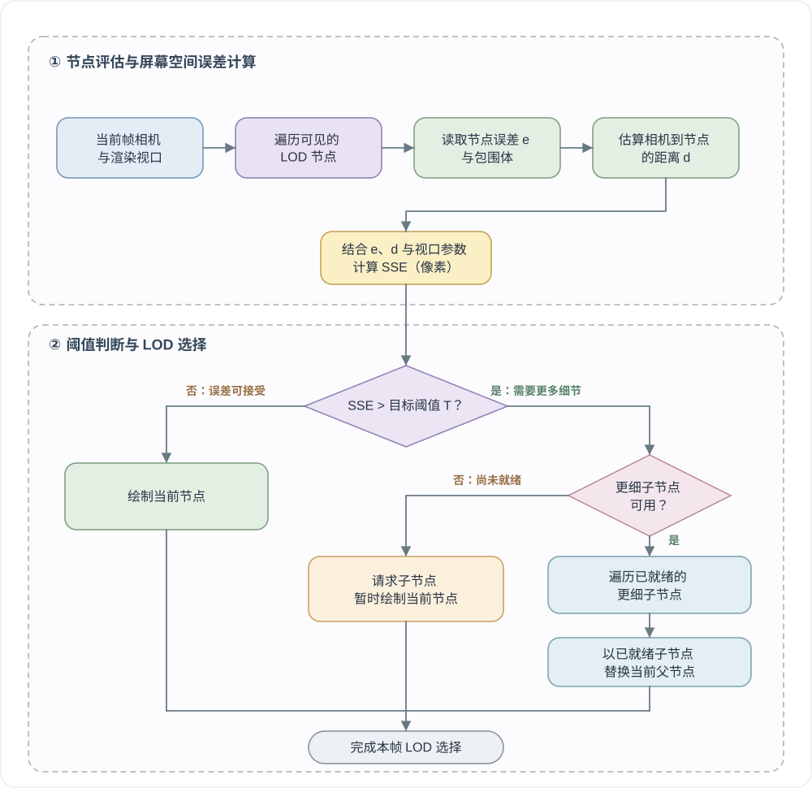

## 1. 概述

渲染大范围地形时，近处地形需要较高精度以避免细节粗糙；远处地形则可适当降低精度，因为其几何误差投影到屏幕后往往难以察觉。若所有地形块都采用最高精度，会产生不必要的三角形开销；若都采用低精度，又会损害近处画质。LOD（Level of Detail）通过为同一对象准备不同精度的模型，并根据观察情况选择合适的层级，以平衡画面质量和渲染开销。

选择层级时，只看物体与相机的距离并不够。不同地形块的几何误差可能不同，而相同的误差在不同视距和视口下也会产生不同的视觉影响。因此，需要衡量当前简化造成的误差投影到屏幕上有多大。**Screen Space Error（SSE，屏幕空间误差）**就是将几何近似误差换算为像素尺度的度量。渲染器根据 SSE 判断是否继续使用当前层级，或切换到更精细的层级。SSE 常用于地形瓦片、网格简化、HLOD 和大场景流式加载。

## 2. 屏幕空间误差的计算

在计算屏幕空间误差之前，先明确它的输入——几何误差 $e$。几何误差用于量化当前简化几何相对于更精细参考几何的形状偏差。具体度量因简化算法而异，常见做法是估计两者之间的最大表面偏差或给出其保守上界；对于地形高度场，也可以使用对应平面位置上的最大高度差。几何误差通常在离线简化或内容构建时计算，并保存为 LOD 节点元数据，单位是世界空间单位（如米）。它描述的是几何空间中的偏差，不是像素误差，简化模型与参考模型的顶点也不一定需要一一对应。

运行时，SSE 将几何误差 $e$ 结合当前相机和投影参数，换算为屏幕上的像素误差估计。它表示简化可能造成多大的屏幕偏差，并非对简化图像与参考图像进行逐像素比较。下面分别介绍透视投影和正交投影下，从世界空间几何误差到屏幕空间误差的计算过程。

### 2.1 透视投影

在透视投影下，物体离相机越远，同样大小的世界空间偏差投影到屏幕上就越小；视口分辨率越高，或纵向视场角越窄，同样的偏差则会占据更多像素。因此，SSE 综合了节点误差、相机距离和投影设置。LOD 系统再将 SSE 与以像素为单位的目标误差阈值比较：SSE 较大时细化节点，SSE 足够小时保留当前层级。

设相机的纵向视场角为 $\theta$，渲染视口高度为 $H$ 像素。透视投影的纵向焦距换算到像素空间后为：

$$
f_{\text{px}} = \frac{H}{2\tan(\theta/2)}
$$

如下图所示，视口可抽象为一个垂直于光轴的成像平面。针孔与视口中心的连线定义了光轴；光轴与穿过视口上下边缘的边界光线构成一个等腰三角形，并将其分成两个直角三角形。取其中一个直角三角形，夹角为 $\theta/2$，对边为半个视口高度 $H/2$，邻边为像素焦距 $f_{\text{px}}$，因此有 $\tan(\theta/2)=(H/2)/f_{\text{px}}$，整理后即可得到上面的公式。

在视场角与像素焦距的关系动画中，视口高度 $H$ 保持不变，成像平面沿光轴前后移动：平面离针孔相机越远，边界光线的夹角 $\theta$ 越小，像素焦距 $f_{\text{px}}$ 越大；反之，平面越近，$\theta$ 越大而 $f_{\text{px}}$ 越小。这里的成像平面是针孔相机模型中用于表示图像坐标的抽象平面，并非显示器的实际表面。

<figure>
<svg viewBox="0 0 720 300" width="100%" role="img" aria-labelledby="sse-focal-title sse-focal-desc" xmlns="http://www.w3.org/2000/svg">
  <title id="sse-focal-title">视场角与像素焦距的关系</title>
  <desc id="sse-focal-desc">针孔相机发出的两条边界光线穿过视口上下边缘。视口高度保持不变，成像平面前后移动时，焦距和视场角反向变化。</desc>
  <defs>
    <marker id="sse-focal-arrow" viewBox="0 0 10 10" refX="10" refY="5" markerWidth="6" markerHeight="6" orient="auto-start-reverse">
      <path d="M 0 0 L 10 5 L 0 10 z" fill="#526579"/>
    </marker>
  </defs>
  <rect x="1" y="1" width="718" height="298" rx="8" fill="#f6f8fa" stroke="#d0d7de"/>
  <line x1="45" y1="145" x2="680" y2="145" stroke="#8c959f" stroke-dasharray="5 5"/>
  <text x="620" y="132" fill="#57606a" font-size="14">光轴</text>
  <circle cx="100" cy="145" r="7" fill="#cf5c36"/>
  <text x="63" y="177" fill="#24292f" font-size="15">针孔相机</text>
  <text x="139" y="121" fill="#0969da" font-size="15">θ/2</text>
  <line x1="100" y1="145" x2="350" y2="55" stroke="#0969da" stroke-width="2">
    <animate attributeName="x2" values="350;450;350" dur="8s" repeatCount="indefinite"/>
  </line>
  <line x1="100" y1="145" x2="350" y2="235" stroke="#0969da" stroke-width="2">
    <animate attributeName="x2" values="350;450;350" dur="8s" repeatCount="indefinite"/>
  </line>
  <path d="M 133 145 A 33 33 0 0 0 131.1 133.8" fill="none" stroke="#cf5c36" stroke-width="1.5">
    <animate attributeName="d" values="M 133 145 A 33 33 0 0 0 131.1 133.8;M 133 145 A 33 33 0 0 0 132 136.8;M 133 145 A 33 33 0 0 0 131.1 133.8" dur="8s" repeatCount="indefinite"/>
  </path>
  <line x1="350" y1="55" x2="350" y2="235" stroke="#24292f" stroke-width="4">
    <animate attributeName="x1" values="350;450;350" dur="8s" repeatCount="indefinite"/>
    <animate attributeName="x2" values="350;450;350" dur="8s" repeatCount="indefinite"/>
  </line>
  <text x="328" y="37" fill="#24292f" font-size="14">视口
    <animate attributeName="x" values="328;428;328" dur="8s" repeatCount="indefinite"/>
  </text>
  <line x1="350" y1="55" x2="366" y2="55" stroke="#526579">
    <animate attributeName="x1" values="350;450;350" dur="8s" repeatCount="indefinite"/>
    <animate attributeName="x2" values="366;466;366" dur="8s" repeatCount="indefinite"/>
  </line>
  <line x1="350" y1="235" x2="366" y2="235" stroke="#526579">
    <animate attributeName="x1" values="350;450;350" dur="8s" repeatCount="indefinite"/>
    <animate attributeName="x2" values="366;466;366" dur="8s" repeatCount="indefinite"/>
  </line>
  <line x1="366" y1="55" x2="366" y2="235" stroke="#526579" marker-start="url(#sse-focal-arrow)" marker-end="url(#sse-focal-arrow)">
    <animate attributeName="x1" values="366;466;366" dur="8s" repeatCount="indefinite"/>
    <animate attributeName="x2" values="366;466;366" dur="8s" repeatCount="indefinite"/>
  </line>
  <text x="382" y="132" fill="#24292f" font-size="15">H（像素）
    <animate attributeName="x" values="382;482;382" dur="8s" repeatCount="indefinite"/>
  </text>
  <line x1="100" y1="235" x2="100" y2="260" stroke="#8c959f"/>
  <line x1="350" y1="235" x2="350" y2="260" stroke="#8c959f">
    <animate attributeName="x1" values="350;450;350" dur="8s" repeatCount="indefinite"/>
    <animate attributeName="x2" values="350;450;350" dur="8s" repeatCount="indefinite"/>
  </line>
  <line x1="100" y1="260" x2="350" y2="260" stroke="#526579" stroke-width="1.5" marker-start="url(#sse-focal-arrow)" marker-end="url(#sse-focal-arrow)">
    <animate attributeName="x2" values="350;450;350" dur="8s" repeatCount="indefinite"/>
  </line>
  <text x="193" y="285" fill="#24292f" font-size="15">f_px（像素焦距）</text>
  <text x="500" y="265" fill="#57606a" font-size="13">成像平面沿光轴移动</text>
</svg>
<figcaption style="text-align: center;">视口高度固定时，焦距越长，视场角越窄。</figcaption>
</figure>

若将几何偏差 $e$ 近似为垂直于视线方向的位移，那么在距相机 $d$ 处，它对应的视角约为 $e/d$（弧度，小角度近似）。再乘以像素焦距 $f_{\text{px}}$，即可得到屏幕空间误差的近似值：

$$
\operatorname{SSE}
\approx \frac{e}{d} \cdot f_{\text{px}}
= \frac{e}{d} \cdot \frac{H}{2\tan(\theta/2)}
\quad \text{pixels}
$$

由公式可知，几何误差 $e$ 或视口高度 $H$ 增大时，SSE 增大；相机距离 $d$ 或纵向视场角 $\theta$ 增大时，SSE 减小。也就是说，更大的模型误差和更高的像素密度会要求更精细的 LOD，而更远的视距和更宽的视野会让同一误差在屏幕上显得更小。公式中的变量和单位如下：

- $e$：当前 LOD 节点相对于更精细参考几何的几何误差估计，单位为世界空间单位（例如米）。通常离线计算，例如对简化网格采样，求采样点到参考几何的最大偏差，或由简化算法给出误差上界，并将结果保存为节点元数据。
- $d$：相机到节点包围球或包围盒的最短欧式距离，单位为世界空间单位（例如米），单位必须与 $e$ 相同。避免只用节点中心距离而低估近处误差。若相机进入包围体附近，应限制距离的最小值或采用其他规则，避免分母接近零导致 SSE 过大。距离估计越近，通常越早细分；估计越远，则可能导致可见细节不足。对于深度范围较大的节点，单个距离和误差值只能提供近似结果。
- $\theta$：相机的纵向视场角（vertical FOV），单位为角度弧度，从相机投影设置读取。
- $H$：实际渲染视口的像素高度，单位为像素（px），从当前渲染视口读取，不一定等于窗口或显示器的高度。
- $f_{\text{px}}$：纵向焦距对应的像素尺度，单位为像素（px）。

假定渲染系统或应用将允许的最大屏幕空间误差设为阈值 $T$，单位为像素（px）。当

$$
\operatorname{SSE} > T
$$ 

时，通常需要继续细化当前 LOD 节点。

### 2.2 正交投影

正交投影不会产生透视缩小，因此相机距离不会改变物体的投影尺寸。SSE 可估算为：

$$
\operatorname{SSE}_{\text{ortho}} \approx e \cdot \frac{H}{S} \quad \text{pixels}
$$

其中，$S$ 表示正交视野垂直方向覆盖的世界空间距离，单位与 $e$ 相同（例如米）；$H$ 沿用前文定义，表示视口高度，单位为像素（px）。比例 $H/S$ 表示每个世界空间单位对应的像素数，因此 SSE 的单位仍为像素。在正交视图中，改变相机距离不会改变同一物体的 SSE；改变视野范围或视口分辨率才会改变误差对应的像素尺度。

### 2.3 SSE 数值计算示例

以透视投影为例，假设某个地形块的几何误差为 $e=1$ 米，相机纵向视场角为 $60^\circ$，视口高度为 $1080$ 像素：

- 距离 $d=100$ 米时，$\operatorname{SSE}\approx 1\times1080/(2\times100\times\tan30^\circ)\approx9.4$ 像素。
- 距离 $d=400$ 米时，$\operatorname{SSE}\approx 1\times1080/(2\times400\times\tan30^\circ)\approx2.3$ 像素。

如果目标误差阈值为 $4$ 像素，距离为 $100$ 米时的误差超过阈值，需要使用更精细的层级；距离为 $400$ 米时的误差低于阈值，可以继续使用当前层级。

因此，LOD 不宜只根据固定距离切换。即使距离相同，视口高度增加或视场角减小，误差投影到屏幕上的像素数也会增加。SSE 将这些因素纳入同一个像素尺度进行比较。

## 3. 基于 SSE 的 LOD 选择流程

每帧渲染时，渲染器从可见的粗层级节点开始遍历，并根据当前相机和视口计算节点的 SSE。如果 SSE 超过目标阈值，就继续访问该节点的子节点；否则绘制当前节点。如果子节点尚未加载，可以先绘制父节点，待子节点加载完成后再替换。


_每帧根据 SSE 判断是否细化节点；子节点尚未就绪时，先请求加载并绘制当前节点。_

上述流程可以写成以下伪代码：

```text
select(node):
    sse = estimateScreenSpaceError(node, camera, viewport)
    if sse <= targetError or node has no finer children:
        render(node)
    else:
        request children if needed
        select each available child
```

阈值决定了细节层级的选择。阈值越小，允许的像素误差越低，通常会选择更精细的层级，同时增加绘制、内存和流式加载开销；阈值越大则相反。阈值并不能保证所有像素误差都不超过该值，实际结果还会受到误差元数据、距离估计和节点加载状态的影响。

以 [Cesium-1.51](https://github.com/CesiumGS/cesium/blob/1.51/Source/Scene/QuadtreePrimitive.js#L694) 版本中地形瓦片的屏幕空间误差计算为例，展示实际工程中的 SSE 计算过程：

```javascript
function screenSpaceError(primitive, frameState, tile) {            // 透视投影
    if (frameState.mode === SceneMode.SCENE2D || frameState.camera.frustum instanceof OrthographicFrustum) {
        return screenSpaceError2D(primitive, frameState, tile);
    }

    var maxGeometricError = primitive._tileProvider.getLevelMaximumGeometricError(tile.level);

    var distance = tile._distance;
    var height = frameState.context.drawingBufferHeight;
    var sseDenominator = frameState.camera.frustum.sseDenominator;

    var error = (maxGeometricError * height) / (distance * sseDenominator);

    if (frameState.fog.enabled) {
        error = error - CesiumMath.fog(distance, frameState.fog.density) * frameState.fog.sse;
    }

    return error;
}

function screenSpaceError2D(primitive, frameState, tile) {          // 正交投影
    var camera = frameState.camera;
    var frustum = camera.frustum;
    if (defined(frustum._offCenterFrustum)) {
        frustum = frustum._offCenterFrustum;
    }

    var context = frameState.context;
    var width = context.drawingBufferWidth;
    var height = context.drawingBufferHeight;

    var maxGeometricError = primitive._tileProvider.getLevelMaximumGeometricError(tile.level);
    var pixelSize = Math.max(frustum.top - frustum.bottom, frustum.right - frustum.left) / Math.max(width, height);
    var error = maxGeometricError / pixelSize;

    if (frameState.fog.enabled && frameState.mode !== SceneMode.SCENE2D) {
        error = error - CesiumMath.fog(tile._distance, frameState.fog.density) * frameState.fog.sse;
    }

    return error;
}
```

## 4. SSE 的作用与局限

- **根据视点选择细节**：渲染器可以根据当前相机、视场角和视口，使用同一套误差数据动态选择 LOD。
- **不负责判断可见性**：遮挡剔除和视锥剔除仍需单独处理。被遮挡的节点即使 SSE 很高，也不一定需要加载。
- **不保证切换平滑**：父子 LOD 的几何边界可能出现裂缝，层级切换也可能产生跳变。地形系统还需要处理相邻地形块的层级约束；必要时可以结合形态混合、滞回阈值或渐进式加载。
- **依赖准确的误差数据**：如果几何误差被低估，细节可能出现得太晚；如果误差被高估，则可能一直选择开销较大的高细节层级。

SSE 将三维空间中的几何误差转换为屏幕上的像素误差。LOD 系统可以根据这个像素尺度和目标阈值，在不同视点下选择合适的细节层级，从而平衡画面质量与渲染开销。
